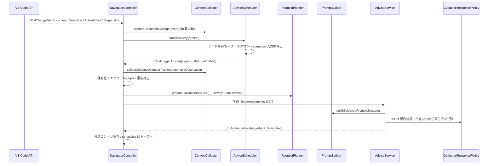
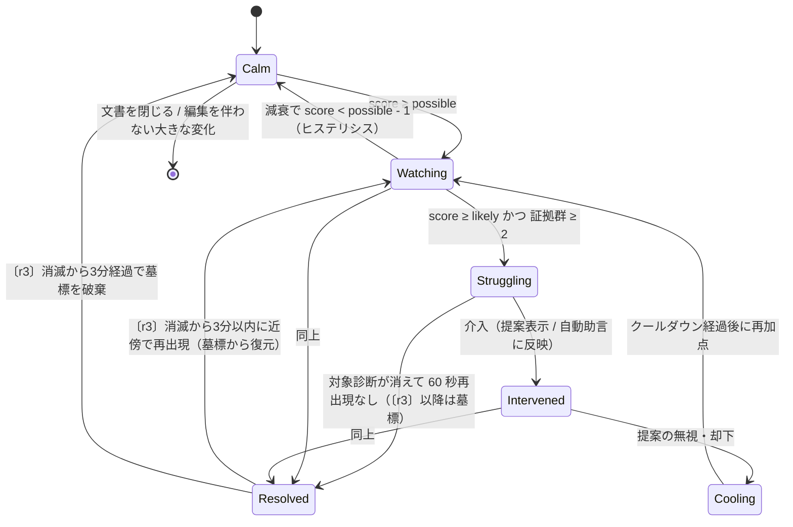
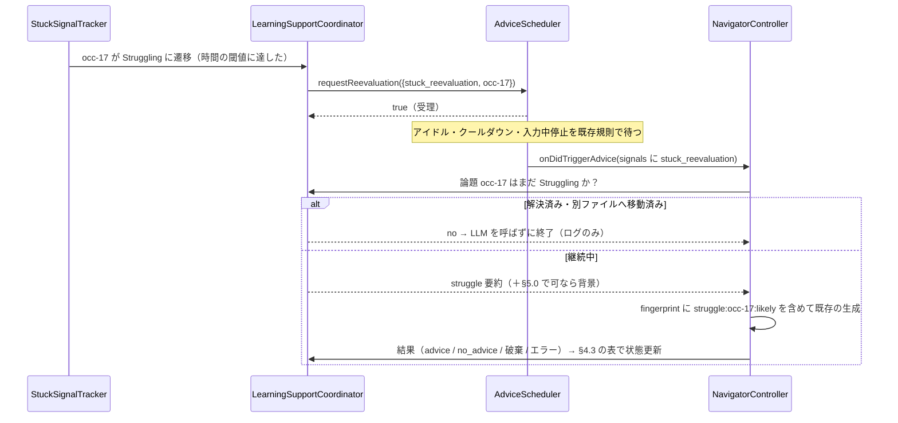
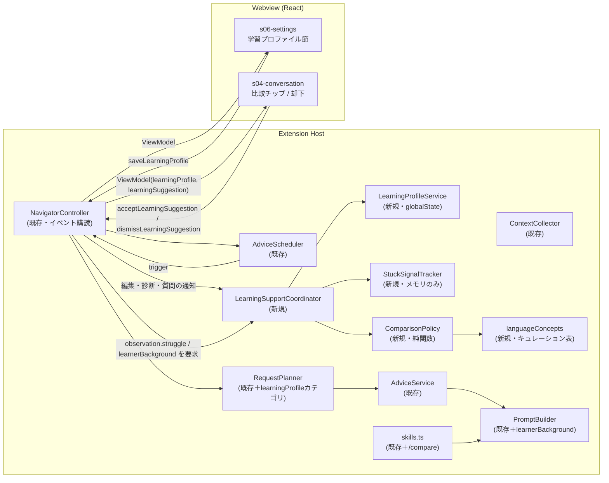
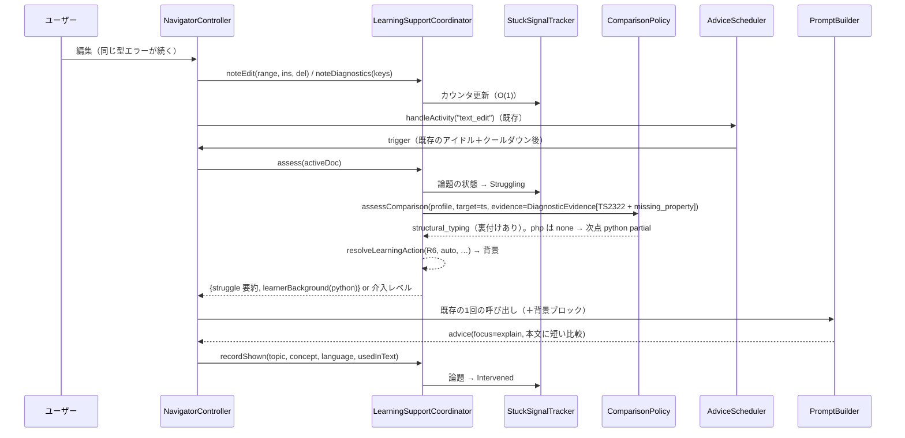
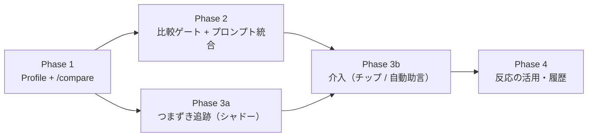

# 学習プロファイル・言語比較支援・つまずき検知 設計検討

- 作成日: 2026-11-26
- 対象リポジトリ: `C:\vol2`（`y4m4s/vol2-project`）
- 位置づけ: Phase 1〜4 全体の調査と技術設計。Phase 1・2 で実装した範囲の仕様は [18. 学習プロファイルと既知言語との比較](18-learning-profile-and-comparison.md)、Phase 3a の仕様は [19. つまずき検知のシャドーモード](19-stuck-detection-shadow-mode.md) を参照
- 状況: Phase 1（学習プロファイル・`/compare`・質問文での明示要求）と Phase 2（比較の自動判定・提案チップ・自動で含める）、Phase 3a（つまずき検知のシャドーモード。仕様は [19](19-stuck-detection-shadow-mode.md)）と Phase 3b（介入。仕様は [20](20-stuck-interventions.md)）は実装済み。Phase 4 は未着手
- 実装時の変更: §3.4 の「学習中の言語」の固定は採用せず、常に編集中のファイルの言語を使う（詳細は 18 を参照）
- 実装時の変更: Phase 2 では `LearningSupportCoordinator` を設けず、比較の判定は `ComparisonPolicy`（純関数）、チップの状態は `NavigatorController` に置いた。Phase 3a でも設けず、つまずき検知は `StuckSignalTracker`（純粋ロジック）と `StuckDetectionCoordinator`（VS Code との接続）に分けた。つまずき検知の設定は `stuckDetection.enabled` ではなく、学習プロファイルの `stuckDetectionEnabled` に置いた
- 表記: **［事実］** はコードまたは `docs/` で確認した内容、**［推測］** は設計上の仮説や未検証の見込み
- 改訂: **r2（2026-11-26）** 外部レビューの指摘7点を反映した。変更点の一覧は §11、変更した節には「〔r2〕」を付けた
- 改訂: **r4（2026-11-26）** 言語指定の規則を2点そろえた（未登録の言語の扱いを自然文とコマンドで統一、送信する言語を1つに統一）。変更点は §11.3、変更した節には「〔r4〕」を付けた
- 改訂: **r3（2026-11-26）** 再レビューを反映した。判断事項3点の確定、明示した言語の優先、再予約の状態管理、解決判定と再発判定の時間窓の整理、旧記述の修正。変更点は §11.2、変更した節には「〔r3〕」を付けた

---

## 0. 結論（先に要点）

採用を推奨する案は次のとおり。

> **「既存の自動助言パイプライン（AdviceScheduler → handleAutomaticGuidance → PromptBuilder の1回呼び出し）はそのまま使う。そこに次の3つを足す。(1) ローカルで動くつまずき信号の追跡器、(2) ローカルの比較ゲート、(3) ゲートを通ったときだけプロンプトへ足す短い学習者背景ブロック。明示的な比較の要求はスラッシュコマンド `/compare` で受ける。」**
>
> ＝ 依頼書 6.2 の **案D（B＋Aの一部＋明示要求用のC）**。比較のためだけの追加 LLM 呼び出しは、ユーザーが明示的に頼んだとき以外は **ゼロ**。

理由は3つある。

1. NaviCom は自動助言で「focus 選択と本文生成を1回の呼び出しで行う」設計を既に確立している［事実: `docs/15` 応答契約］。比較の要否を別の呼び出しで判定すると、この設計方針とコスト方針の両方に反する。
2. `LanguageReference.ts` が「ローカルの正規表現で条件を満たしたときだけ短い仕様メモを足す」という同じ型の仕組みを既に持っている［事実］。比較ゲートはこれを一般化したものとして自然に収まる。
3. 既定モードは `manual`［事実: `SettingsService` DEFAULT_SETTINGS］なので、多くのユーザーは自動 LLM 呼び出しを使っていない。そこでつまずき検知は **LLM を呼ばずにローカルの控えめな提案チップを出すだけ** にし、クリックされた時点で初めて LLM を呼ぶ。こうすると manual ユーザーにも価値が届き、コストもかからない。

〔r2〕レビューを受けて、次の4つの骨格を確定した。

- モードの判定を1か所（§5.0 の動作表）に集約した
- 診断を「種類」と「発生」に分けて追跡する（§4.2）
- 時間経過で深まったつまずきに対する、スケジューラへの再判定の予約経路を設けた（§4.5）
- チップを提案時の文書と論題に結び付け、クリック時に再検証する（§7.2）

あわせて、比較の適用可否は「診断コードで候補を出し、別の種類の裏付けで確定する」方式に改めた（§5.1）。

依頼書のフェーズ順は、Phase 3 を **「3a: 記録のみのシャドーモード → 3b: 介入を有効化」** に分けることを提案する。根拠のない閾値で最初から介入しないためである（§9）。

---

## 1. 現状分析

### 1.1 既存アドバイス機構

#### 全体フロー［事実］



#### 項目別の調査結果

| 調査項目 | 結果［事実］ | 主なファイル・関数 |
|---|---|---|
| 取得しているエディタ情報 | アクティブファイルのパス・言語・抜粋（最大8,000字）、選択（最大4,000字）、診断（プレビューは5件）、直近編集（文書ごとに最大5件、TTL 5分、前後プレビュー100字）、関連ファイル、ワークスペースツリー | `services/ContextCollector.ts` `collectGuidanceContext()` ほか |
| イベント取得 | `NavigatorController.initialize()` 内で `onDidChangeActiveTextEditor`（実際に対象が変わったときだけ）、`onDidChangeTextDocument`（`contentChanges` が空なら無視）、`onDidChangeTextEditorSelection`（選択ありのみトリガー、カーソル移動はアイドル延長）、`onDidChangeDiagnostics`（`hasDiagnosticsContentChanged` で同内容の再発行を無視）、ファイル作成・削除・リネーム | `application/NavigatorController.ts` L305–368 |
| 自動アドバイスの実行条件 | `mode === "always"`、接続済み、一時停止していない、`requestState === "idle"`、チャット入力中でない。アイドル待ちとクールダウンを両方満たすこと。Controller 側では日次トークン上限（超過したら自動一時停止）と、意味のある文脈があるかも確認する | `services/AdviceScheduler.ts` `isModeActive()` / `ensureScheduled()`、`NavigatorController.handleAutomaticGuidance()` |
| 生成タイミング | 最後の操作から `idleDelayMs`（5/10/15秒）経過し、かつ前回の完了から `requestIntervalMs`（20/60/180秒）経過したとき。シグナルは理由ごとに最新時刻へ更新して最大5件 | `AdviceScheduler`、`SettingsService` の選択肢 |
| LLM 呼び出し | `AdviceService` → `ConnectionService`。プロバイダーは Copilot / LM Studio / Ollama / OrcaRouter で、自動ルーティングあり | `services/AdviceService.ts`、`ConnectionService.ts`、`shared/providerRouting.ts` |
| プロンプト組み立て | `PromptBuilder.buildGuidancePrompt()`。`ContextBudget`（文字数ベース、`modelProfile.contextBudget × 3`）でブロックごとに予算内へ収める。参照データと制御指示を分離し、`neutralize` で区切り文字を無害化する。ナレッジは `<personal-knowledge>`、フィードバック傾向は手動相談のときだけ入る | `services/PromptBuilder.ts`、`ModelProfile.ts` |
| 自動時の focus 判定 | LLM が `continue / review / explain / overview / none` の1つを選び、`{"kind":"advice","focus":..,"text":..}` または `{"kind":"no_advice","focus":"none"}` を返す。**判定専用の追加呼び出しはない**（形式不正なら修正再生成を最大1回）。指示文には「Inactivity does not prove that the user is stuck.」が明記されている | `PromptBuilder.getInstructionByKind()`、`GuidanceResponsePolicy.ts`、`docs/15` |
| 重複抑止 | 文脈・深さ・観測から作る fingerprint を直前値と最大50件のセットで比較する（`no_advice` も成功として登録）。停止時間・前回 focus・診断差分は fingerprint に含めない。ファイルごとの前回 focus と、全体像を表示済みかも保持する。すべてセッション内のメモリ | `NavigatorController` `automaticFingerprints` / `automaticFocusByFile`、`createAutomaticFingerprint` |
| 陳腐化対策 | 収集開始時のエディタスナップショット（URI・version・選択位置）と比べ、変化していれば再キューまたは破棄 | `ContextCollector.automaticEditorSnapshot()` |
| 表示 | 会話ストリームに `NaviCom（自動・次の一手）` などのラベル付きで保存・表示する。`no_advice` はフロート通知のみ（連続した none は履歴に残さない） | `shared/automaticGuidance.ts`、`views/screens/s04-conversation.tsx` |
| 無視・却下の仕組み | 回答ごとの Good/Bad 評価と理由（`too_long` / `off_topic` / `gives_answer` / `too_vague` など）、自動助言の一時停止トグル、モード切替。**「この種の提案を今後出さない」という却下機能はない** | `FeedbackStore.ts`（`advice_kind` 列あり）、`shared/feedback.ts`、`messages.ts` `toggleAutoPause` |
| コンテキスト・トークン制御 | `ContextBudget`、推論強度（low/high）による出力上限、`RequestPlanner` による送信予定カテゴリの開示と除外 glob の適用、日次トークン上限、`UsageMeter` | `RequestPlanner.ts`、`UsageMeter.ts`、`GuidanceDepthPolicy.ts` |
| 送信内容の透明性 | `ContextCategoryKey` ごとに送信予定を表示し、実際にプロンプトへ入ったブロックと照合する（`onBlock` コールバック） | `RequestPlanner.ts`、`docs/request-plan-transmission.md`、`RequestPlanDisclosure.tsx` |

#### 既存機能の拡張で済む部分と、新しい仕組みが必要な部分

| 区分 | 内容 |
|---|---|
| **拡張で済む** | イベント購読（既存ハンドラーへ1行ずつ通知を足す）、自動助言の発火・待機・陳腐化・重複抑止、プロンプトへのブロック追加（`PromptBuilder` の `tail` / `add` パターン）、送信予定カテゴリの追加、会話表示、Good/Bad フィードバック、設定画面のセクション追加、スラッシュコマンド追加（`shared/skills.ts` のレジストリだけで完結［事実: types.ts のコメント］）、評価ハーネス（`src/eval/`） |
| **新規が必要** | 学習プロファイルの保存とサービス、つまずき信号の追跡（時間窓をまたぐ集計は現在どこにもない）、比較ゲートと概念カタログ、介入判定（「控える・提案だけ・生成する」の区別）、概念単位の却下・再表示抑止、manual モードでも動く軽量なローカル提案 |

#### 再利用する上での注意点

- **［事実］** `ContextCollector.diagnosticSnapshot()` のキーには **行・列の位置が含まれる**。そのため、上の行を編集して診断の位置がずれただけでも「新規の診断」とみなされる。つまずき検知で「同じエラーが続いている」を判定するには、**診断の種類を表すキー** と **個々の発生箇所を追跡する ID** を分けて持つ必要がある（§4.2〔r2〕）。
- **［事実］〔r2〕** `DiagnosticSummary`（`shared/types.ts`）は `severity` / `message` / `source` / `line` だけを持ち、**`code` を持たない**。`collectDiagnostics()` も `diagnosticSnapshot()` も、収集の時点で `vscode.Diagnostic.code` を捨てている。比較ゲートが診断コードを使うには、正規化した `code` と範囲を受け渡す経路が必要になる（§5.1）。
- **［事実］〔r2〕** `AdviceScheduler.dispatchPendingTrigger()` は、発火時に `pendingTriggerReason` と `signals` を消す。そのため発火後に編集や診断の変化がなければ、時間の経過だけでは次の発火が起きない。つまずき判定が時間経過で深まった場合の再判定には、専用の予約経路が必要になる（§4.5）。
- **［事実］〔r2〕** チャットやチップからの相談（`askForGuidance` → `buildCurrentContextGuidanceOptions`）は、**実行時点のアクティブエディタ** から文脈を集める。提案を出した時点の文書や論題に結び付ける仕組みはない（§7.2）。
- **［事実］** 直近編集は最大5件・5分で切り捨てられる。区間ごとの反復編集を数える用途には足りないため、集計値（カウンタ）を別に持つ。本文は持たない。
- **［事実］** `AdviceScheduler` は `always` 以外では状態を持たない（`isModeEnabledForUi`）。manual モードでのつまずき検知は、スケジューラとは別の軽量タイマーで行う必要がある。

### 1.2 設定・永続化機構

| 項目 | 結果［事実］ |
|---|---|
| VS Code 設定画面（`settings.json`） | `contributes.configuration` には `aiPairNavigator.copilotProbeTimeoutSeconds` しかない。NaviCom の設定は基本的に Webview の中で完結している |
| Webview 設定 UI | `views/screens/s06-settings.tsx`。セクションは「AI 接続／モード設定／助言の頻度／利用量／除外設定」。保存は `saveSettings` メッセージ → `NavigatorController.saveSettings()` → `SettingsService` |
| ユーザー設定の保存先 | `SettingsService` は **`context.workspaceState`**（キー `aiPairNavigator.phase2.settings`）。つまり **ワークスペース単位** で保存される。正規化では選択肢へのスナップ（`normalizeIdleDelayMs` など）と型ガードを行っている |
| globalState の使用 | `UsageMeter`、`ContextSourceRegistry`（workspaceState と併用） |
| secrets | `OrcaRouterCredentialStore`（`context.secrets`） |
| SQLite（sql.js） | `conversations.sqlite`（`storageUri`＝ワークスペース単位。なければ globalStorage 配下）、`knowledge.sqlite`・`feedback.sqlite`・プロバイダー評価（`globalStorageUri`＝ユーザー単位）。`AtomicFileStorage.openDatabaseWithBackup` と `ensureColumn` による列追加マイグレーションのパターンが確立している |
| ユーザー単位の情報 | ナレッジ、フィードバック、利用量、プロバイダー評価は globalStorage / globalState。**「ユーザーの属性」を保持する仕組みはまだない** |

### 1.3 再利用できる実装（一覧）

| 再利用対象 | 用途 |
|---|---|
| `NavigatorController` の既存イベントハンドラー | つまずき追跡器への入力。新しい listener は原則追加しない（ウィンドウのフォーカスだけ追加を検討） |
| `ContextCollector.captureDocumentChange` の `observation`（行範囲・挿入/削除文字数） | 編集チャーンの集計 |
| `AutomaticGuidanceObservation` | つまずきの要約を観測情報として LLM に渡す |
| `LanguageReference.ts` のパターン | ローカル判定で条件付きの短い参照ブロックを足す、という前例 |
| `PromptBuilder` の `ContextBudget` と `onBlock` | 学習者背景ブロックを予算内に収め、送信予定と照合する |
| `RequestPlanner` のカテゴリ | 「学習プロファイル」カテゴリを足して送信を開示する |
| `shared/skills.ts` | `/compare` の追加 |
| `SettingsService` の正規化パターン | `LearningProfileService` の実装の型 |
| `FeedbackStore` / Good・Bad 評価 | 比較説明の有用性フィードバック（Phase 4） |
| `src/eval/`（fixtures / runner / live）、`test/` | 比較要否と品質の回帰評価 |
| `writeDiagnostic`（NaviCom Diagnostics 出力チャネル） | シャドーモードでの判定ログ |

---

## 2. 機能要件の整理

### 2.1 MVP で必要な機能

1. 既知言語の登録・変更・削除（複数）。習熟度は任意
2. 比較説明モード（オフ／求めたときだけ／控えめに提案／自動で含める）
3. 学習対象言語は「自動（編集中の言語）」を既定とし、固定もできる
4. `/compare` による明示的な比較説明（〔r3〕§5.0 の表に従う。`onRequest`・`suggest`・`auto` では適用可否の判定を通さずに実行する。`off`、またはプロファイル未設定のときは LLM を呼ばずに案内を出す。比較言語は §5.1 の優先順位で決める）
5. 〔r2〕比較モードと相談の種類に応じて、「背景を送る／チップだけ／何もしない」を1か所で決める（§5.0 の動作表）。背景ブロックを暗黙に送るのは `auto` モードだけにする
6. 同じ概念への重複提示の抑止（セッション内）と、概念単位の「今後出さない」
7. 送信予定に「学習プロファイル」を表示する

### 2.2 将来追加する機能

- つまずき検知による介入（Phase 3b）。その他の学習支援（エラー解決ヒント、段階的ヒント、Skills・ドキュメントの提案）への流用
- 比較説明への反応（Good/Bad、展開率）による頻度の自動調整
- 苦手分野の集計（SQLite）、メンター向けの可視化
- 習熟度の自動推定（今回は対象外）

### 2.3 非機能要件

| 区分 | 要件 |
|---|---|
| 性能 | キー入力ごとの処理は O(1) のカウンタ更新だけにする。判定は「トリガー時」と「低頻度タイマー時」にまとめて行う。文書本文を走査しない |
| コスト | 比較の判定に LLM を使わない。追加トークンはゲートを通ったときだけで、1ブロック数百字以内 |
| プライバシー | つまずき信号はメモリ上だけに持ち、コード本文を保持しない。プロファイルはローカル保存で同期しない。外部送信は送信予定に開示し、言語名と習熟度だけを送る |
| UX | 既存の介入抑止（アイドル・クールダウン・入力中停止）を迂回しない。却下を尊重する。無効化は1クリック |
| 互換性 | プロファイル未設定なら現行と完全に同じ挙動（プロンプトも fingerprint も変えない） |

---

## 3. Learning Profile の設計

### 3.1 データモデル

```ts
// shared/learningProfile.ts（新規）
export type ProficiencyLevel = "basic" | "working" | "advanced";

export interface KnownLanguage {
  /** 正規化済みの言語ファミリーID（例: "typescript"。typescriptreact は typescript に寄せる） */
  languageId: string;
  /** 任意。未指定は「不明」として扱い、比較言語の選択では working 相当とみなす */
  level?: ProficiencyLevel;
}

export type ComparisonMode = "off" | "onRequest" | "suggest" | "auto";

export interface LearningProfile {
  schemaVersion: 1;
  knownLanguages: KnownLanguage[];          // 最大 8 件程度
  /** "auto" = 編集中の言語。固定する場合は言語ID */
  targetLanguage: "auto" | string;
  comparisonMode: ComparisonMode;           // 〔r3〕既定 "onRequest"
  stuckDetection: { enabled: boolean };     // 既定 true（ただし Phase 3b まではログのみ）
  /** 概念単位の「今後出さない」。キー例 "typescript:nullability" */
  dismissedConcepts: string[];              // 上限 100 件、古いものから削除
}
```

### 3.2 習熟度は「任意・3段階」にとどめる

- 自己申告の精度は高くないと見込んでいる［推測］。そこで細かい段階（5段階や年数）は設けない。比較言語を選ぶ（advanced を優先する）ことと、説明の前提を変える（basic の言語には概念名だけで頼らない）ことの2点にだけ使う。
- **未指定を正式な値として扱う**。言語を選んだだけで保存できるようにして、登録の手間を最小にする。
- 学習対象の言語を advanced として登録している場合は、比較説明を行わない（既に詳しい言語に、別言語との比較は不要なため）。

### 3.3 言語の識別と正規化

- VS Code の `languageId` を一次キーにする。`vscode.languages.getLanguages()` は json・markdown・plaintext なども返すため、UI の選択肢は **キュレーションしたプログラミング言語のリスト**（約20言語）にし、表示名を付ける［推測: 選択肢のノイズを避けるため］。
- ファミリーへの正規化表（例）を持つ。

| languageId | ファミリー |
|---|---|
| `typescript`, `typescriptreact` | `typescript` |
| `javascript`, `javascriptreact` | `javascript` |
| `php` | `php` |
| `python` | `python` |
| `c`, `cpp` | それぞれ別（混同は誤った類推の原因になりやすい） |
| `csharp`, `java`, `go`, `rust`, `ruby`, `kotlin`, `swift`, `dart` | そのまま |

- 比較対象から除く言語: `json`, `jsonc`, `markdown`, `plaintext`, `yaml`, `html`, `css`（Phase 1 では除外。HTML/CSS 学習者向けの扱いは未決定事項 §10.3）。

### 3.4 学習対象言語の決め方

| 方式 | 長所 | 短所 |
|---|---|---|
| 明示設定のみ | 誤認がない | 設定の手間がかかる。複数言語のプロジェクトで固定値がずれる |
| 自動検出のみ | 手間がない | 設定ファイルや既知言語を編集しているときにも誤って対象になる |
| **組み合わせ（推奨）** | 既定は自動で、必要なときだけ固定できる | ロジックが1段増える |

推奨ルール: `targetLanguage === "auto"` の場合は、アクティブファイルのファミリーを学習対象とする。ただし次のときは「学習中ではない」とみなし、比較を行わない。

- そのファミリーが既知言語として advanced で登録されている
- 除外言語（json など）である
- ファイルが除外 glob に一致する（既存の `RequestPlanner` の判定を再利用する）

### 3.5 保存方法の比較

| 保存先 | 評価 |
|---|---|
| 既存の `SettingsService`（workspaceState）に相乗りする | ✕ プロファイルは「ユーザーの属性」なので、ワークスペースごとに再登録させるのは不適切 |
| **`globalState` の独立キー（推奨）** | ◎ ユーザー単位で、小さく、マイグレーションが容易。`aiPairNavigator.learningProfile.v1` |
| `contributes.configuration`（settings.json） | △ オブジェクトの配列は VS Code の設定 UI で扱いにくい。既存方針（Webview 内で完結）とも合わない |
| SQLite | △ MVP には過剰。将来の学習履歴（つまずきの集計、比較の反応）は `globalStorageUri/learning.sqlite` を新設するか、`feedback.sqlite` へテーブルを追加する |

- `globalState.setKeysForSync()` は **呼ばない**（Settings Sync で他のマシンへ送らない）。将来はオプトインで検討する。
- ワークスペースごとの上書きは学習対象言語の固定だけに必要になる可能性がある［推測］。MVP ではグローバルのみとし、要望があれば `workspaceState` に `targetLanguage` だけを持たせる。
- プロファイル未設定（`knownLanguages` が空）の場合: ゲートは常に「比較なし」を返す。プロンプト・fingerprint・送信予定は現行と同一にする。`/compare` 実行時は「設定画面で既知言語を登録してください」という導線を表示する。

### 3.6 `LearningProfileService`（新規）

`SettingsService` と同じ形にする（`get()` / `save()` / `reset()`）。正規化は型ガード、未知の languageId の破棄、重複除去、件数上限で行う。将来の `schemaVersion` 移行もここに置く。

---

## 4. Stuck Detection の設計

### 4.1 利用できる信号の評価

| 信号 | 取得 API | 処理コスト | 兆候としての信頼性 | 誤検知要因 | プライバシー | 既存の再利用 |
|---|---|---|---|---|---|---|
| ① 同じエラーが継続している | `onDidChangeDiagnostics` + `getDiagnostics(uri)` | 低（アクティブ文書のみ、最大100件のキー計算） | **中〜高**。編集が伴う場合に限る | 書きかけのコード（入力途中の一時的なエラー）、意図的に放置している TODO | キーはハッシュ化したメッセージで保持し、本文を持たない | ◎ 既存のハンドラー。〔r2〕種類キーと発生 ID を別に持つ（§4.2） |
| ② 同じ領域を何度も修正している | `onDidChangeTextDocument` の `contentChanges.range` | 低（行バケットのカウンタ） | 中。①と組み合わさると高い | 正常なリファクタリング、整形（formatter）、補完の受け入れ | 行番号のみ | ◎ `captureDocumentChange` と同じ箇所 |
| ③ 修正しても同じエラーが再発する | ①のキーの「解消 → 再出現」 | 低 | **高**（試行錯誤が失敗していることを直接示す） | 構文の書き換え途中に一瞬だけ消えて戻る | 同上 | ○ |
| ④ 同じテーマの質問が繰り返される | `askForGuidance` 呼び出し時の入力 | 低（トークン集合の Jaccard 類似度） | 中 | 深掘りのための追加質問（良い学習行動でもある） | 質問文の正規化トークン（最大20語）をメモリにだけ置く | ○ Controller 内 |
| ⑤ エラーがある状態で操作が停滞している | 最終操作時刻 + `window.state.focused` | 極小 | **低**（離席・思考・ドキュメント閲覧と区別できない）。単独では使わない | 離席、他アプリでの調査、会議 | なし | ○ `idleDurationMs`。`onDidChangeWindowState` を新たに追加 |
| ⑥ 短時間に追加と削除を繰り返す | `contentChanges` の挿入・削除文字数 | 極小 | 中 | undo/redo、補完の候補選び直し | 文字数のみ | ◎ `observation.insertedCharCount / deletedCharCount`。〔r2〕②と同じ行動を測っているため、独立の信号にせず②の成立条件に統合する（§4.2） |

**単独で介入根拠にしてよい信号はない**、という前提で設計する。既存プロンプトの「Inactivity does not prove that the user is stuck」と同じ立場である。

#### 除外・減衰条件（誤検知対策）

| 条件 | 扱い［閾値は仮説］ |
|---|---|
| 1回の変更で挿入が 500 字超、または 30 行超 | 貼り付けや AI 生成とみなし、チャーン計測から除外する |
| `onDidRenameFiles` やマルチファイルの一括変更の直後 | 60秒間はチャーン計測を止める（リファクタリング） |
| `vscode.debug.activeDebugSession` が存在する | ⑤（停滞）を数えない（デバッグ中の観察は正常） |
| ウィンドウが非フォーカス | ⑤を数えない（離席・他アプリ） |
| 除外 glob に一致するファイル、ワークスペース外のファイル、untitled | 追跡しない |
| エラーが生じてから最初の 20 秒以内 | 持続とみなさない（入力途中のため） |
| 文書の version が編集を伴わずに大きく変化した（git checkout など） | その文書の追跡状態をリセットする |

### 4.2 判定アルゴリズムの比較

| 方式 | 実装難度 | 説明可能性 | 誤検知への強さ | 調整のしやすさ | 評価 |
|---|---|---|---|---|---|
| ルールベース（if 連鎖） | 低 | 高 | 低（ルールが増えると衝突する） | 低 | 単独では不足 |
| 複数条件のスコアリング | 低〜中 | 中〜高（寄与を列挙できる） | 中 | **高**（重みと閾値を定数化できる） | ◎ 中核に採用 |
| 状態遷移 | 中 | 高 | **高**（ヒステリシスと解決時のリセットを表現できる） | 中 | ◎ スコアの外側に採用 |
| 既存アドバイス生成への統合（LLM の focus 判定に任せる） | 低 | 低 | 中 | 低 | ○ 最終判断の一部として使う（観測として渡す） |
| 必要なときだけ LLM に判定させる | 中 | 低 | 中〜高 | 低 | ✕ 判定のための呼び出しは避ける。ただし自動助言の本呼び出しの中で判断させるのは可 |

**推奨: 「スコアリング（論題ごと）＋ 状態遷移（ヒステリシス）＋ 最終的な発話判断は既存の自動助言呼び出しに委ねる」**

#### 「論題（topic）」という単位

つまずきは **論題ごと** に追跡する。

〔r2〕r1 では位置を含まない診断キーをそのまま論題にしていた。この方式では、同じファイルの2か所に同じ診断が出ると両方が1つの論題にまとまる。その結果、片方を直しても解決扱いにならず、片方への却下がもう片方にも及ぶ。そこで **「種類」と「発生」を分ける**。

| 概念 | キー | 用途 |
|---|---|---|
| 診断の種類 `diagKind` | `source` ＋ 正規化した `code` ＋ 正規化したメッセージの型（引用部 `'…'` と数値をプレースホルダーに置換）のハッシュ | 比較ゲートの概念候補、再発の判定、将来の苦手分野の集計 |
| 発生 `occurrenceId` | 文書ごとの連番 ID（例 `occ-17`）。生成時の `diagKind`・範囲・直近の範囲を保持する | **論題そのもの**。持続・解決・却下・介入済みはすべて発生単位で管理する |
| 領域 `regionId` | 編集チャーン用の発生 ID。編集範囲から作り、同じ追随規則で維持する | 診断を伴わないチャーン |

論題 ID は `occurrenceId` または `regionId` とする。`diagKind` は論題の **属性** であり、識別子ではない。

**発生の追随（位置変更への対応）**: 診断が更新されるたびに、新しい診断の集合を既存の発生へ対応付ける。

1. `onDidChangeTextDocument` の `contentChanges` で、既存の発生の範囲を移動する（変更範囲より後ろの行は、挿入行数から削除行数を引いた分だけずらす。変更範囲と重なる発生は「編集で触れた」印を付ける）。これは O(変更数 × 発生数)。発生は文書あたり最大 20 件なので十分に小さい［推測］。
2. 新しい診断ごとに、同じ `diagKind` を持つ既存の発生のうち、移動後の範囲との行距離が最も近いもの（±3 行以内、H-14）に対応付ける。対応付けは1対1にする（貪欲法で、距離の近い順）。
3. 対応先がない診断は、新しい発生にする。対応付けられなかった既存の発生は「消滅候補」とし、60 秒（H-15）再出現しなければ `Resolved` にする。
4. 〔r3〕`Resolved` にした発生は、すぐには破棄しない。**消滅した時刻から 3 分（H-2）まで**、照合用の最小記録（墓標）を残す。
5. 消滅候補の間、または墓標が残っている間に、同じ `diagKind` の診断が近傍（±3 行）に再出現した場合は、同じ発生の **再発** として扱う（証拠群 B）。離れた位置に出た場合は、別の発生とする。

〔r3〕r2 では、消滅から 60 秒で発生の状態を破棄していた。一方で、再発の時間窓は 3 分だった。そのため、2 分後に再出現しても同じ発生の再発として扱えず、証拠群 B が実質的に 60 秒の窓でしか働かなかった。時間の関係を次のように整理する。

```text
t0          t0+60s(H-15)               t0+3min(H-2)
|-- 消滅候補 --|------- 墓標（Resolved）-------|  破棄
   状態はすべて保持   最小記録のみ保持
   再出現 → 再発       再出現 → 再発（記録から復元）   以降の再出現 → 新しい発生
```

- 再発の時間窓は、**消滅した時刻** から数える。解決とみなす時点（60 秒）は、時間窓の起点ではない。
- 墓標に残すのは、次の最小限の項目だけにする。コードの本文や診断のメッセージは残さない（メモリ上だけ）。

| 項目 | 用途 |
|---|---|
| `occurrenceId`、`diagKind`、消滅時の範囲、消滅時刻 | 再出現した診断との照合 |
| 消滅時のスコア | 復元した発生に引き継ぐ（そこへ B の加点をする。時間減衰も適用する） |
| 再判定の記録（§4.5 の `reevaluation`）、却下・介入済みの印 | 同じ問題を短い間に繰り返し通知しないため |

- 墓標から復元した発生は `Watching` から再開する。スコアが閾値を超えていれば、そこから `Struggling` へ遷移する。ただし、墓標の期限内に復元した場合は、介入済み・却下の印を引き継ぐ。同じ論題に再び介入するのは、墓標の期限が切れて新しい発生になった後である。
- 「解決したこと」の後段への通知（`Resolved` イベント）は、60 秒の時点で送る。墓標の期限内に再発した場合は、`Reopened` イベントを送り、集計の側で取り消せるようにする（Phase 4 の苦手分野の集計で、解決回数を水増ししないため）。
- 文書あたりの墓標は、最大 20 件（発生と合わせた上限とは別）とする。文書を閉じたら破棄する。

この規則により、2か所に同じ診断がある場合でも、片方の解決・却下はその発生だけに作用する。同じ種類の診断が繰り返し出ることは `diagKind` 単位の集計（Phase 4）で扱い、論題の状態とは混ぜない。

これにより「同じ問題への繰り返し通知の抑止」「解決時のリセット」「却下」を論題（発生）単位で扱える。また、比較ゲートやエラー解決支援など後段の機能へ、`occurrenceId` と `diagKind` を組で渡せる。

#### スコア（仮設定）

〔r2〕r1 では ②チャーン と ⑥追加・削除の反復 を別々の信号として加点していた。しかし「挿入と削除の差が総量の 20% 未満」なら、削除は必ず総量の 40% を超える。つまり②が成立すると⑥も必ず成立し、同じ編集行動を2種類の根拠として数えていた。そこで信号を **証拠群（evidence group）** にまとめ、加点の上限と「信号の種類数」を群の単位で数える。⑥は独立した信号から外し、②の成立条件の一部にする。

| 証拠群 | 成立条件 | 加点［仮説 H-x］ | 群の上限 |
|---|---|---|---|
| A. 診断の持続 | 同じ発生が 90 秒以上存在し、その間に発生の範囲と重なる、または±5 行以内の編集が 2 回以上ある | +2（H-1） | 4（AとBの合計） |
| B. 診断の再発 | 同じ発生が消滅してから 3 分以内（〔r3〕消滅候補または墓標の間）に、近傍へ再出現 | 1 回につき +2（H-2） | （Aと共有） |
| C. 編集の往復 | 同じ領域への編集イベントが 2 分以内に 4 回以上あり、正味の変化が小さい（挿入と削除の差が総量の 20% 未満、H-3）。往復の回数（挿入が主の変更と削除が主の変更の切り替わり）が 2 回以上 | +1（H-4）、往復が 4 回以上なら +2 | 2 |
| D. 質問の反復 | 10 分以内の質問同士の Jaccard 類似度が 0.5 以上、または同じ発生への言及 | +2（H-5） | 2 |
| E. 停滞 | エラーがあり、フォーカスがあり、デバッグしておらず、45 秒以上操作がない | +1（H-6） | 1 |

- A と B は「同じ診断が直らない」という1つの事実の別の現れなので、**1つの群として数え、上限も共有する**。
- `possible` は合計が 3 以上（H-7）
- `likely` は合計が 5 以上（H-8）、**かつ成立した証拠群が2つ以上**（H-9）。E（停滞）は単独で信頼性が低いため、群の数には数えない（加点だけ）。つまり `likely` には、A/B・C・D のうち2群以上が必要になる
- 群の独立性を保つため、同じ編集イベントが A（持続の条件である周辺編集）と C の両方に使われることは許容する。ただし C が成立するには、A の条件より多い編集回数（4 回以上）と往復の条件が必要になる。この重なりが誤検知の原因になるかは、シャドーモードのログで確認する（§9 Phase 3a の確認項目）［推測］
- スコアは時間で減衰する（半減期 5 分、H-10）。単発の重い操作が長く残らないようにするため

> これらの数値は **検証用の初期値** であり、最適値ではない。すべて `StuckHeuristics` 定数オブジェクトに集約し、シャドーモードのログで校正する（§9 Phase 3a）。

#### 状態遷移（論題ごと）



- `Resolved` は「解決したことの検知」として後段へ通知する。将来のエラー解決支援で「解けましたね」という振り返りに使える。ただし MVP では表示しない。
- 一度 `Intervened` になった論題は、`Resolved` を経ない限り再び介入しない（同じ問題への繰り返し通知の抑止）。

### 4.3 検知後の動作（介入レベル）

つまずき判定（StuckAssessment）と比較の適用可否（ComparisonApplicability）は **別々に** 計算する。〔r2〕両者を合成して最終的な動作を決めるのは、§5.0 の動作表を実装した `resolveLearningAction()` **1か所だけ** にする。ここでは、つまずき側から見た介入レベルの意味だけを定める。

| レベル | 名称 | つまずき側の条件 | 最終的な動作（§5.0 の表で決まる） |
|---|---|---|---|
| L0 | 兆候なし | Calm | 何もしない |
| L1 | 兆候ありだが介入しない | Watching、Cooling、却下済み、入力中、介入クールダウン中 | 何もしない（シャドーモードではログのみ） |
| L2 | 通常の助言 | Struggling かつ 比較が不適用 | always: 再判定を1回予約（§4.5）。manual: チップ「このエラーについて相談する」 |
| L3 | 比較を提案 | Struggling かつ 比較が適用可、かつモードが `suggest` | always: 再判定を予約（背景なし）し、結果のカードの後に比較チップ。manual: 比較チップのみ |
| L4 | 比較を含む助言 | Struggling かつ 比較が適用可、かつモードが `auto` | always: 再判定を予約（背景あり）。manual: チップ「相談する」（クリック時に背景あり） |

追加ルール:

- **明示的な質問は検知を待たない**。手動相談ではつまずき判定を参照せず、§5.0 の表に従う。
- 介入のクールダウンは **2層** にする。既存の `requestIntervalMs`（自動助言全体）と、つまずき介入専用のクールダウン（同一論題は解決まで1回、論題をまたいでも 10 分に1回、H-11）。
- 却下された論題は `Cooling` に移す。概念単位で「今後出さない」を選ばれた場合は `dismissedConcepts` に永続化する。
- 自動介入の無効化: `stuckDetection.enabled = false` にすると追跡器自体を止め、イベントの集計もしない。

#### 〔r2〕「介入済み」にする時点

r1 では、どの時点で `Intervened` にするかが決まっていなかった。提示（offer）と完了（delivered）を分けて扱う。

| 出来事 | 論題の状態 | 介入クールダウン（H-11） | 備考 |
|---|---|---|---|
| チップを表示した | `Offered`（Struggling の副状態） | 消費しない | 同じ論題のチップは1つだけ。表示中は再表示しない |
| チップが無視されたまま論題が解決 | `Resolved` | 消費しない | |
| チップの ✕ | `Cooling` | 消費する | |
| 生成を開始した（チップのクリック、always の再判定） | `InFlight` | まだ消費しない | 二重の介入を防ぐため、この間は同じ論題の再予約・再表示をしない |
| `advice` を表示した | `Intervened` | 消費する | |
| `no_advice` | `Intervened` | 消費する | LLM が「言うことはない」と判断したもの。同じ状態で繰り返し聞かない |
| 陳腐化で破棄（文書が変わった） | Struggling に戻す | 消費しない | 新しい状態で改めて評価する。〔r3〕繰り返しの上限は §4.5 の `staleDiscards` |
| ユーザーのキャンセル | `Cooling` | 消費する | キャンセルは「今は要らない」という意思とみなす |
| 通信・プロバイダーのエラー | Struggling に戻す | 消費しない。ただし同じ論題の再試行は1回まで（〔r3〕§4.5 の再判定の記録で管理） | 既存のエラー表示に従う。エラーのたびに再試行を繰り返さない |

#### always モードでの統合方法［推測を含む］

自動助言の観測 `AutomaticGuidanceObservation` に、任意の要約フィールドを追加する。

```ts
struggle?: {
  level: "possible" | "likely";
  signals: ("persistent_error" | "recurring_error" | "edit_churn" | "repeated_question" | "idle_with_error")[];
  topic?: { kind: "diagnostic"; occurrenceId: string; line: number; code?: string } | { kind: "region"; regionId: string; lineStart: number; lineEnd: number };
  durationSec: number;
}
```

- コード本文は含めない（診断本文は既存の `diagnostics` で送られる）。
- プロンプトには「これは推定であり、断定しない。具体的な助けになる根拠がなければ none を選ぶ」という制約を添える。既存方針との整合のため。
- **fingerprint への影響**: 現状、同じ文脈で一度 `no_advice` になると、その後は再送されない。そこで、§4.5 の再判定で発火した場合に限り、fingerprint に `struggle:<occurrenceId>:likely` を含める。これで再判定の機会は論題ごとに1回になる。〔r2〕ただし、fingerprint を変えるだけでは発火そのものが起きない（レビュー指摘3）。発火の経路は §4.5 で別に用意する。

#### manual モードでの統合方法

- 追跡器は manual でも動く（イベントは既に届いている）。
- 判定は軽量タイマーで行う。〔r2〕15 秒ごとのポーリング（r1 の H-12）はやめ、§4.5 の「次の期限のタイマー」を always と共用する。Struggling になったら、ViewModel に `learningSuggestion` を載せ、会話画面の入力欄の上に控えめなチップを1つ出す。
- **LLM は呼ばない**。チップをクリックすると、提案に結び付いた文脈で相談を1回実行する。〔r2〕このとき、文脈の再検証を行う（§7.2）。

### 4.4 他の学習支援への再利用（疎結合）

```ts
// 追跡器は「何が起きているか」だけを返し、何をするかは知らない
interface StuckAssessment {
  documentKey: string;
  topicKey: string;
  state: "Calm" | "Watching" | "Struggling" | "Intervened" | "Cooling" | "Resolved";
  score: number;
  signals: { kind: SignalKind; weight: number; at: number }[];
  diagnostic?: { source?: string; code?: string; messageHash: string; line: number };
  since: number;
}
```

- `onDidChangeAssessment` イベントを購読する側（介入方針、将来のエラー解決支援、段階的ヒント、苦手分野の集計）は互いを知らない。
- 苦手分野の集計やメンター向けの可視化は、`Resolved` イベントを集計して（論題の種類・診断コード・所要時間だけを）SQLite へ保存する形にする。本文は保存しない。Phase 4 以降で、オプトインにする。

### 4.5 〔r2〕時間経過で深まったつまずきの再判定経路（always モード）

#### 問題［事実］

`AdviceScheduler.dispatchPendingTrigger()` は、発火時に `pendingTriggerReason` と `signals` を消す。以降の発火は `handleActivity()`（エディタのイベント）からしか起きない。そのため、編集した直後に自動助言が `no_advice` を返し、その後ユーザーが手を止めて考え込んだ場合を考えると、90 秒たって論題が `Struggling` になっても、次の生成は起きない。fingerprint を変えても、発火そのものがないので効果がない。

#### 設計

スケジューラに、**ユーザー操作ではない再判定の予約** を受け付けるメソッドを1つ追加する。

```ts
// AdviceScheduler（追加）
/** 学習支援からの再判定。ユーザー操作とは扱わない。受け付けた場合 true */
public requestReevaluation(signal: { reason: "stuck_reevaluation"; topicId: string }): boolean
```

| 項目 | `handleActivity()`（既存） | `requestReevaluation()`（追加） |
|---|---|---|
| 入力中フラグ（`composerActive`） | false に戻す（エディタ操作のため） | **変更しない**。入力中ならタイマーを止めたまま保留し、入力終了後に既存の規則で発火する |
| `lastActivityAt` | 現在時刻へ更新 | **更新しない**（操作ではないので、アイドル待ちを延ばさない） |
| 一時停止・切断・manual | 保留を破棄 | **受け付けずに false を返す**。一時停止の意思を尊重し、予約を溜めない |
| クールダウン | 適用 | **同じく適用**（`ensureScheduled()` をそのまま使う） |
| `requestState !== "idle"`（生成中） | 保留して完了後に発火 | 同じ |
| 既存の保留がある | 理由を更新 | 既存の保留に `stuck_reevaluation` シグナルを合流させる（理由は上書きしない） |
| シグナル | `AdviceTriggerReason` | `AdviceTriggerReason` に `"stuck_reevaluation"` を追加する。観測の `triggerReasons` にも出るので、LLM は「操作による発火ではない」と区別できる |

`LearningSupportCoordinator` は、論題が `Struggling` に入った時点で次の条件をすべて満たすときに1回だけ呼ぶ。

- `mode === "always"` で、つまずき検知が有効（シャドーモードでないこと）
- 〔r3〕その論題の再判定の記録（下の「再判定の状態管理」）が `idle` で、試行回数が上限未満である
- 介入クールダウン（H-11）中でない

`false` が返った場合（一時停止など）は何もしない。manual モードでは、この経路を使わずにチップを出す（§4.3）。

#### 発火時の検証と後始末



- 発火時のシグナルが `stuck_reevaluation` **だけ** で、その論題がもう `Struggling` でない（解決済み、または別のファイルへ移動済み）場合は、LLM を呼ばずに終了する。予約を取り消す API を別に作るより単純で、取り消し漏れも起きない。
- ユーザー操作のシグナルと合流して発火した場合も、struggle の要約は発火時点の評価で付ける。この場合も予約は消費済みとして扱う。
#### 〔r3〕再判定の状態管理

r2 では、§4.3 で「通信エラーや陳腐化の後は `Struggling` に戻し、再試行は1回まで」とした。一方で §4.5 では「一度予約した論題は、解決するまで再予約しない」としていた。この組み合わせでは、表にある再試行を実行できない。そこで、論題の状態（`Struggling` など）とは別に、**再判定の記録** を論題ごとに持つ。

```ts
interface ReevaluationRecord {
  phase: "idle" | "scheduled" | "inFlight" | "done";
  attempts: number;      // 生成を開始した回数（陳腐化による破棄は数えない）
  staleDiscards: number; // 生成後の陳腐化による破棄の回数
  lastOutcome?: "advice" | "no_advice" | "cancelled" | "error" | "stale" | "dropped" | "skipped";
}
```

| 出来事 | 遷移 | `attempts` | 備考 |
|---|---|---|---|
| `requestReevaluation()` が true を返した | idle → **scheduled** | 変えない | |
| `requestReevaluation()` が false を返した（一時停止など） | idle のまま | 変えない | 状態が変わったとき（一時停止の解除など）に、条件を満たしていれば再度試みる |
| スケジューラが保留を破棄した（一時停止、manual への切替、切断、キャンセル） | scheduled → **idle**（`dropped`） | 変えない | スケジューラの `onDidChangeState` の時点で、保留中のシグナルに自分の論題が残っているかを照合して検出する |
| 発火した。論題がもう Struggling でない | scheduled → **done**（`skipped`） | 変えない | LLM は呼ばない |
| 発火した。生成を開始した | scheduled → **inFlight** | +1 | |
| 収集中に陳腐化し、既存の `requeueStaleTrigger` で再キューされた | inFlight → **scheduled** | −1（開始を取り消し） | 既存のスケジューラがシグナルを引き継ぐので、こちらで再予約はしない |
| `advice` / `no_advice` を表示した | inFlight → **done** | — | 論題は Intervened（§4.3） |
| ユーザーがキャンセルした | inFlight → **done**（`cancelled`） | — | 論題は Cooling |
| 生成後に陳腐化して破棄した（文書が変わった） | inFlight → **idle**（`stale`） | −1（数えない）。`staleDiscards` +1 | `staleDiscards` が 2（H-16）に達したら **done** にする。編集のたびに生成を繰り返さないため |
| 通信・プロバイダーのエラー | inFlight → **idle**（`error`） | — | `attempts` が上限（H-17: 2 回 = 初回＋再試行 1 回）に達していれば **done** |
| 論題が Resolved になり、墓標が期限切れになった | 記録を破棄 | — | 墓標の期限内の再発では、記録を引き継ぐ（同じ問題に何度も介入しないため） |

- 再予約の条件は、`phase === "idle"` かつ `attempts < 上限` かつ 論題が `Struggling` かつ 介入クールダウン外であること、の4つすべてを満たすこととする。
- エラーの後の再試行は、すぐには予約しない。次の通常のトリガーか、次の期限のタイマーの時点で条件を満たしていれば予約する。既存のスケジューラのクールダウンも通常どおり効く。
- `inFlight` の間は、同じ論題についてチップも出さない（§4.3 の `InFlight` と同じ）。

- 時間で深まる判定には、ポーリングではなく **次の期限のタイマー** を使う。例えば、発生ごとの「持続 90 秒に達する時刻」のうち最も早いものに `setTimeout` を1つだけ張る。エラーがない間はタイマーも張らない（manual モードの判定も、同じ仕組みを使う）。

---

## 5. Adaptive Explanation の設計

### 5.0 〔r2〕比較モード × 相談の種類 × 明示要求の動作表

r1 では、ゲートの手順1が `off` しか除外しなかった。一方で、手動相談への背景の追加と介入レベルにはそれぞれ別の条件があり、どこで最終的に止めるのかが不明確だった（レビュー指摘1）。そこで責務を次のように分ける。

- **`assessComparison()`**（§5.1）: 「比較が内容的に成り立つか」だけを判定する。**モードを見ない**。
- **`resolveLearningAction(requestKind, mode, explicit, applicability, struggle)`**: 下の表をそのまま実装した純関数。**モードを判定する唯一の場所** にする。表の全セルを列挙する表駆動の単体テストで保証する。

出力は次の4種類とする。

- **背景**: 学習者背景ブロックを今回のプロンプトへ含める
- **チップ**: 背景は送らない。回答（または提案）の後に比較チップを出し、クリックされたら §5.3 の `/compare` 相当を、提案に結び付いた文脈で1回実行する
- **なし**: 何もしない
- **案内**: LLM を呼ばず、設定への導線を出す

前提: `knownLanguages` が空なら、`/compare` は「案内」、それ以外はすべて「なし」になる。「適用可」は `assessComparison()` が yes を返した場合を指す。

| 相談の種類 | 明示的な比較要求 | `off` | `onRequest`（〔r3〕既定） | `suggest` | `auto` |
|---|---|---|---|---|---|
| R1 手動相談（質問・選択範囲の相談） | なし | なし | なし | 適用可なら **チップ**（回答の後） | 適用可なら **背景** |
| R2 手動相談 | あり（質問文に登録済みの言語名と比較の語。例「PHPでいう〜」「Pythonと比べて」） | なし（質問文だけで答える。プロファイルは使わない） | **背景** | **背景** | **背景** |
| R3 `/compare` | あり（コマンド自体が明示） | **案内**（「比較説明はオフです」＋有効化の導線） | **背景** | **背景** | **背景** |
| R4 他のスラッシュコマンド（`/next` `/flow` `/risk` `/test`） | — | なし | なし | なし | なし |
| R5 自動助言（操作による通常の発火） | — | なし | なし | 背景なしで生成。結果が `advice` で適用可なら **チップ** | 適用可なら **背景** |
| R6 自動助言（§4.5 の `stuck_reevaluation` による発火） | — | なし（※） | なし（※） | R5 と同じ | R5 と同じ |
| R7 つまずきチップ「このエラーについて相談する」のクリック（manual） | — | 背景なし | 背景なし | 背景なし。回答の後、適用可なら **チップ** | 適用可なら **背景** |
| R8 比較チップのクリック | あり（クリックが明示） | （表示されない） | （表示されない） | **背景**（提案時の論題・概念に固定） | （表示されない） |

（※）`off` と `onRequest` でも、つまずき検知が有効なら R6 の発火自体は起きる（比較とは関係がないため）。比較の背景を付けないだけである。

補足:

- **明示的な比較要求（R2・R3・R8）では、§5.1 の手順 3〜5 と 8 を飛ばす**。概念を特定できない場合は、言語だけを指定した背景ブロック（概念なし）を送り、対応概念の有無の判断は `/compare` の指示に従って LLM に任せる。手順 6（却下）は R8 以外では尊重しない（ユーザーが自分で頼んでいるため）。
- R2 の判定はローカルの正規表現で行う。登録済みの言語の表示名と別名（例 `PHP`・`php`、`Python`・`パイソン`）に、比較の語（「でいう」「と比べ」「と違」「みたいな」「比較」）が組み合わさった場合に限る。言語名が単に出てきただけでは明示要求とみなさない。
- 〔r3〕**明示された言語は、自動選択より優先する**（§5.1 の「比較言語の決定順」）。例えば PHP と Python を登録していて「PHPでいう〜」と聞かれた場合、対応度や習熟度で Python の方が上位でも、必ず PHP を使う。
- 〔r3〕質問文が **未登録の言語** を比較の語と一緒に指定した場合（例: PHP だけを登録していて「Rubyでいう〜」）は、R2 とはみなさない。〔r4〕言語を2つ以上指定した場合も同じ扱いにする（§5.1 の「明示指定の共通規則」）。ただし、その質問では登録済みの別の言語を背景として **自動で付けない**（`auto` モードの R1 であっても「なし」にする）。ユーザーが指定した言語と違う言語を混ぜると、質問の意図に反するためである。質問文に言語名があるので、LLM はプロファイルなしで比較できる。
- `suggest` で回答の後に出すチップは、1回の回答につき1つまでとする。比較チップとつまずきチップが同時に該当する場合は、比較チップを優先する（つまずきへの相談は、その回答で既に済んでいるため）。
- `no_advice` の後には、チップを出さない（LLM が「言うことはない」と判断したため）。

### 5.1 比較の適用可否の判定（`assessComparison()`）

〔r2〕つまずきと比較の要否を分けるため、適用可否は次の順で評価する純関数とする（`services/ComparisonPolicy.ts`）。**モードはここでは見ない**（§5.0）。

```text
assessComparison(profile, target, evidence, history) → { applicable: false, reason } | { applicable: true, language, concept, mapping, confidence }

1. knownLanguages 空                                                  → no ("no_profile")
2. target が学習対象でない（§3.4）                                    → no ("not_learning")
3. evidence から概念の「候補」を抽出する（診断コード・キーワード・質問）→ 候補なしなら no ("no_candidate")
4. 候補ごとに裏付けを確認し、裏付けのない候補を捨てる                → 残らなければ no ("unconfirmed")
5. 概念が「些末」カテゴリ（typo・構文の欠落・未使用変数）            → no ("trivial")
6. dismissedConcepts に target:concept がある                         → no ("dismissed")
7. 概念カタログで、既知言語に direct/partial の対応がない             → no ("no_counterpart")
8. 同一セッションで同じ target:concept:language を提示済み（30分以内）→ no ("recently_shown")
9. 比較言語を決める（〔r3〕下の「比較言語の決定順」）
→ yes
```

#### 〔r3〕比較言語の決定順

上から順に適用し、最初に決まったものを使う。下位の規則で上位の指定を上書きしない。

| 順位 | 指定の出どころ | 対象 | 内容 |
|---|---|---|---|
| 1 | 質問文での指定（R2） | 手動相談 | 質問文に、比較の語と一緒に登録済みの言語が **1つだけ** 出てきた場合は、その言語を使う。〔r4〕複数の言語を指定された場合（「PHPとPythonでは」、登録済みと未登録の混在も含む）は、R2 とはみなさず、プロファイルの背景を付けない。質問文に沿って回答させる（下の「明示指定の共通規則」） |
| 2 | `/compare` の引数 | `/compare php` | 引数で指定した言語（登録済みのもの）を使う。〔r4〕未登録の言語（`/compare ruby`）なら、別の言語へ差し替えず、LLM を呼ばずに登録の案内を出す（「Ruby は学習プロファイルに登録されていません。[登録する]」）。引数を2つ以上指定した場合も、LLM を呼ばずに「比較する言語を1つ指定してください」と案内する［推測: 引数の解析は既存の `parseSlashInput` に、`/next deep` と同じ形で言語の引数を足す必要がある］ |
| 3 | チップに固定された言語（R8） | 比較チップのクリック | 提案時に `LearningSuggestion.language` へ固定した言語を使う。クリック時に再計算しない（提案の文言と違う言語で説明しないため） |
| 4 | 自動選択 | R1・R5・R6・R7、引数なしの `/compare` | 対応度 direct > partial、同点なら習熟度 advanced > working > 未指定 > basic。それも同点なら、プロファイルの登録順 |

#### 〔r4〕明示指定の共通規則

自然文（R2）と `/compare` の引数は、どちらもユーザーによる言語の明示指定なので、同じ原則で扱う。**明示された言語を別の言語に差し替えない。送るプロファイルの言語は常に1つにする。**

| 明示指定の内容 | 自然文（R2） | `/compare` の引数 |
|---|---|---|
| 登録済みの言語が1つ | その言語で背景を送る | その言語で背景を送る |
| 未登録の言語が1つ | 背景を付けない（質問文に沿って回答する。登録済みの別の言語を混ぜない） | 背景を付けず、LLM も呼ばない。登録の案内を出す |
| 言語が2つ以上（登録の有無を問わない） | 背景を付けない（質問文に沿って回答する） | 背景を付けず、LLM も呼ばない。「1つ指定してください」と案内する |

- 自然文とコマンドで「未登録」「複数」の結果が違うのは、自然文には答えるべき質問が別にあるのに対し、`/compare` は比較そのものを頼むコマンドだからである。プロファイルを使わずに比較だけを行うと、習熟度に応じた説明ができず、`/compare` を使う意味が薄れる。どちらの場合も、明示された言語を別の言語へ差し替えないという原則は同じである。
- これにより、プロンプトの背景ブロック、送信予定の開示、プライバシーの記載（§8.2）がすべて「1言語だけを送る」という契約のままで済む。複数の言語を背景として送る必要が出た場合は、Phase 2 以降に契約ごと見直す。

- 順位1〜3の明示指定では、手順7（`no_counterpart`）を適用しない。指定された言語に対応する概念がない（カタログで `none`）場合も、その言語を使う。背景ブロックには対応度 `none` をそのまま書き、「直接の対応がないことと、その理由」を説明させる。ユーザーが自分で指定した言語なので、別の言語へ差し替えない。
- 順位4の自動選択でだけ、手順7で `none` の言語を除外する。

#### 〔r2〕候補の抽出と裏付け（レビュー指摘7）

r1 では、診断コードから概念を直接決めていた。しかし、例えば TS2322（Type 'X' is not assignable to type 'Y'）は、単なる `string` と `number` の不一致でも発生する。これを `structural_typing` と判定すると、問題と関係の薄い Python の `Protocol` との比較につながる。そこで **診断コードは候補の抽出にだけ使い、裏付けが1つ以上なければ比較しない**。

裏付けとして使える証拠は次の3種類で、候補を出した根拠とは別の種類であることを条件にする。

| 証拠 | 内容 | 例（`structural_typing`） |
|---|---|---|
| メッセージの型 | 診断メッセージが、概念に固有の形をしているか（正規表現） | 「Property 'x' is missing in type」「is missing the following properties」、または `'{ … }'` や interface 名を含む型同士の非互換。**`'string'` と `'number'` のようなプリミティブ同士なら不成立** |
| 周辺のコード | 診断の範囲（±2 行）や選択範囲に、概念に固有の構文があるか | オブジェクトリテラル、`interface`／`type` 宣言の参照、`implements` |
| 質問文 | 手動相談の質問に、概念に関する語があるか | 「インターフェース」「型が合わない」「構造」 |

候補ごとの規則の例（カタログの各概念に `candidates` と `corroboration` を持たせる）:

| 概念 | 候補の根拠 | 必要な裏付け（いずれか1つ） | 裏付けがない場合 |
|---|---|---|---|
| `structural_typing` | TS2322 / 2345 / 2741 | メッセージがオブジェクト型や interface を含む、または周辺コードにオブジェクトリテラルや interface がある | 比較しない（プリミティブの不一致は `primitive_types` 候補へ回す） |
| `primitive_types`（文字列と数値の扱い） | TS2322 / 2345 で、型が両方プリミティブ | 周辺コードに暗黙の変換を前提にした式（`+` による連結、比較、フォーム値の読み取り）がある | 比較しない（単純な型の書き間違いとして、通常の助言に任せる） |
| `nullability` | TS18047 / 18048 / 2532、`?.`・`??` | メッセージに `'null'` または `'undefined'` を含む（コードからの候補なら、周辺にプロパティアクセスや `?.` がある） | 比較しない |
| `async_promise` | TS1308、`await`／`Promise`（キーワード） | 診断が付いている、またはカーソルや選択がそのキーワードの上にある | 比較しない（`async` を含むファイルを開いただけでは出さない） |
| `array_methods` | `.map(` などのキーワード | 選択やカーソルがその呼び出しの上にある、または質問文に関連語がある | 比較しない |

- `primitive_types` は PHP の型の自動変換（type juggling）との比較が役立つ見込みがある［推測］。ただし、誤った類推を生みやすい概念でもある。カタログには入れるが、評価ケース（§9.2 C11〜C13）で効果を確認してから有効にする。
- 抽出と裏付けの結果（候補、採用した証拠、却下の理由）は、Diagnostics に記録する。メッセージの本文は記録しない。

#### 〔r2〕診断コードの受け渡し（レビュー指摘4）

**［事実］** `DiagnosticSummary` には `code` がなく、`collectDiagnostics()`・`diagnosticSnapshot()` のどちらも収集時に `vscode.Diagnostic.code` を捨てている。さらに、自動助言の観測では `diagnostics.added`（`DiagnosticSummary[]`）を **`JSON.stringify` でそのままプロンプトへ入れている**（`PromptBuilder.ts` L165）。

したがって、`DiagnosticSummary` に `code` を足すと、既存の自動助言のプロンプトと fingerprint が変わり、`docs/15` の回帰評価をやり直すことになる。そこで **送信用の型は変えず、ローカル専用の型を別に作る**。

```ts
// shared/types.ts（追加。プロンプトには入れない）
export interface DiagnosticEvidence {
  source?: string;              // 例 "ts"
  code?: string;                // 正規化済み。例 "2322"
  severity: DiagnosticSeverityLabel;
  messageShape: string;         // 引用部と数値をプレースホルダーにした型。ハッシュの元
  messageFeatures: string[];    // 裏付け用の特徴。例 ["object_type", "missing_property"]。本文は持たない
  range: { startLine: number; startCharacter: number; endLine: number; endCharacter: number };
}
```

- `ContextCollector.collectDiagnosticEvidence(uri)` を追加する。既存の `getDiagnostics(uri)` の結果から作り、アクティブな文書だけを対象にする。除外 glob の判定は既存と同じにする。
- `code` の正規化: `vscode.Diagnostic.code` は `string | number | { value: string | number; target: Uri }` の形を取る。`value` だけを文字列化し、`target`（ドキュメントの URL）は捨てる。`source` は小文字にそろえる。
- `messageFeatures` は、§5.1 の裏付け規則が使う特徴だけを、正規表現で抽出する。
- 受け渡しの経路: `ContextCollector` → `LearningSupportCoordinator` → `assessComparison()`（Phase 2）と `StuckSignalTracker`（Phase 3a）。どちらも同じ `DiagnosticEvidence` を使うので、`diagKind` の計算（§4.2）もここに一本化する。
- 自動助言と手動相談のどちらでも、`prepareGuidanceRequest` の直前に1回だけ作る。プロンプトに入るのは、§5.3 の背景ブロックだけである。

`evidence` として使うものの一覧:

- 上記の `DiagnosticEvidence`（アクティブ文書のみ）
- 選択テキスト、カーソル付近の抜粋（既存。キーワードの検出は正規表現で軽量に行う）
- 手動相談の質問文（明示要求の判定にも使う。§5.0）

#### 些末カテゴリの例（比較しない）

| 例 | 根拠 |
|---|---|
| TS `2304`/`2552`（Cannot find name / Did you mean …） | スペルミスの可能性が高い |
| TS `1005`/`1128`（`;` expected など） | 構文の欠落 |
| TS `6133`（未使用） | 学習上の論点ではない |
| ESLint の整形系ルール | 規約の問題 |

#### 概念カタログ（`shared/languageConcepts.ts`、新規・小さく始める）

`LanguageReference.ts` と同じく **キュレーションした小さな表** にする。MVP は TypeScript を学習対象とする 6〜8 概念 × 主要 8 言語程度を想定する。

| concept（TS 側） | 検出の例 | PHP | Python | Java | Go |
|---|---|---|---|---|---|
| `nullability`（`null`/`undefined`、`?.`、`??`） | 18047/18048/2532、`?.` | partial（`?Type`、`??`。ただし `undefined` に相当するものはない） | partial（`Optional`/`None`） | partial（`Optional`、NPE） | partial（ゼロ値/`nil`） |
| `structural_typing`（interface・型の互換） | 候補: 2322/2345/2741。〔r2〕裏付け必須（§5.1） | none（名前的型） | partial（`Protocol`） | none（名前的型） | direct（暗黙の interface 実装） |
| `async_promise` | 1308、`await`/`Promise` | none（標準では同期。Fibers は別概念） | direct（`async`/`await`） | partial（`CompletableFuture`） | partial（goroutine/channel は異なるモデル） |
| `array_methods`（map/filter/reduce） | `.map(` など | partial（`array_map` は引数順が異なる） | partial（内包表記） | partial（Stream） | none |
| `generics` | `<T>`、2344 | none（PHPDoc のみ） | partial（`TypeVar`） | direct（ただし型消去の違い） | partial（1.18+） |
| `equality`（`===` と `==`） | `==` の使用 | direct（PHP にも `===` がある。比較規則は異なる） | partial | partial | none |
| 〔r2〕`primitive_types`（文字列と数値の扱い） | 候補: 2322/2345 で両方プリミティブ。裏付け必須 | partial（type juggling。TS は暗黙に変換しない） | partial（暗黙の変換をしない点は近い） | partial | partial |

- `none` の言語は比較に使わない。ただし「PHP には直接対応する概念がない」と伝えること自体が有益な場合はある（例: async）。その扱いは LLM に委ねず、**カタログに `noteWhenNone: true` を付けた概念だけ** で許可する［推測: 誤った類推を防ぐため、許可を明示制にする］。
- カタログは誤りが混入しやすい資産である。`docs/language-reference.md` と同様に出典と確認日を記録し、評価ケースと対にして管理する。

### 5.2 生成方式の比較（依頼書 6.2）

| 観点 | 案A: プロンプトに常時プロファイル | 案B: ローカルで絞り込んで追加 | 案C: 比較専用の呼び出し | **案D: B＋明示要求用のC（推奨）** |
|---|---|---|---|---|
| 実装難度 | 低 | 中（ゲートとカタログ） | 中（新 skill と UI） | 中 |
| 追加トークン | **毎回** +100〜300字。自動助言の全呼び出しに乗る | ゲートを通ったときだけ | 比較のたびに1回分まるごと | 自動・手動はゲート時のみ。C はユーザーが明示したときだけ |
| 応答速度 | 変わらない | 変わらない | 追加の往復でローカル LLM では数秒〜数十秒 | 変わらない（C は明示時のみ） |
| 説明品質 | 不要な比較が混ざりやすい（指示があってもモデルは使いたがる傾向［推測］） | 概念が限定されるため類推の質が上がる | 専用の指示で最も深くできる | 自動は短く正確に、深掘りは C で |
| 既存への影響 | fingerprint と全プロンプトが変わり、回帰評価をやり直す必要がある | 未設定時は差分ゼロ | skill の追加だけ | 同左 |
| 判定コスト | LLM 内（無料に見えるが毎回トークンがかかる） | ローカル O(1) | なし | ローカル O(1) |

案A を採らない理由: 既存の自動助言は「最小限の介入」と「none を積極的に選ぶ」ことを重視して調整されている［事実: `docs/15` の回帰評価の経緯］。全プロンプトへ背景情報を常時足すと、この調整済みのバランスを崩す危険がある。

### 5.3 既存プロンプトとの統合方法

- `GuidancePromptInput` に任意の `learnerBackground?: LearnerBackground` を追加する。`PromptBuilder` は knowledge ブロックの近く（tail 側）に、予算内で1ブロックだけ追加する。`onBlock("learningProfile")` を呼んで送信予定と照合する。
- `ContextCategoryKey` に `"learningProfile"`（表示名「学習プロファイル」）を追加する。`RequestPlanner` は、ゲートを通ったときだけ `included: true` にする。

ブロックの例（ゲートが PHP・nullability を選んだ場合）:

```text
## Learner background (untrusted reference data)
<learner-background>
- 学習中: TypeScript / 既知: PHP（実務経験あり）
- 着目概念: nullability（null / undefined、?. 、??）
- 対応度: partial — PHPの ?Type・?? は近いが、undefined に相当する値はない
</learner-background>
Use this only if a comparison genuinely helps with the current focus.
- At most 2 sentences of comparison inside the selected focus; do not add a separate section.
- State at least one concrete behavioral difference (runtime, type system, or error handling). Never claim equivalence from syntax alone.
- If the comparison would not help or might mislead, omit it entirely and explain in TypeScript terms only.
- Do not mention languages other than the one listed.
```

- **既知言語のすべてを送らない**。選ばれた1言語だけを送る。
- 自動助言の JSON 契約（`GuidanceResponsePolicy` は余分なキーを拒否する［事実］）は MVP では変更しない。比較を「実際に使ったか」は、応答本文に比較言語の表示名が含まれるかどうかで判定する（ローカルの文字列チェック）。重複抑止の記録にはこれで足りる［推測］。精度が不足する場合は、Phase 4 で `"compared": "php"` のような任意キーを契約に追加する。

#### `/compare`（新規スキル）

- `shared/skills.ts` に `compare` を追加する。`userEntryText` は「既知の言語と比べて説明してください」。
- 〔r2〕§5.0 の明示要求の規則に従う（`assessComparison()` の手順 3〜5 と 8 を飛ばし、言語選択の手順 9 は行う）。プロファイルが空、または `off` のときは「案内」を出す。
- 〔r3〕`/compare php` のように、引数で比較言語を指定できるようにする（§5.1 の決定順の順位2）。
- 指示は上のブロックより詳しくする（「対応する書き方 → 挙動の違い → 注意点」の3段構成、比較コードは最小限、完成コードは出さない、という既存の学習方針を守る）。

### 5.4 トークン消費の抑制

| 施策 | 効果［推測］ |
|---|---|
| ゲートを通ったときだけブロックを追加 | 大半のリクエストで追加ゼロ |
| 送る言語は1つ、概念は1つ | ブロックは 200〜350 字程度 |
| `ContextBudget` 内に収める（不足時は落とす。比較は任意情報のため） | 予算の小さいモデルでも本体の文脈を守れる |
| `ModelProfile.terse` のモデルでは、自動では比較を「対応度 direct のときだけ」に制限 | 小型モデルの誤った類推を抑える（要評価） |
| 30 分以内の同一概念は再送しない | 繰り返しのコストを防ぐ |

### 5.5 比較説明の品質管理

- **構文上の類似と意味上の類似を区別する**: カタログの `mapping` に「似ている点」と「違う点」を必ず対で持たせ、プロンプトで「違いを1つ以上述べる」ことを要求する。
- **対応概念がない場合**: `none` の言語は使わない。`noteWhenNone` の概念だけ「直接の対応はない」と伝えることを許可する。
- **比較しない判断**: ゲートの拒否理由（`reason`）を Diagnostics に記録し、評価で「出すべきでない場面で出していないか」を確認できるようにする。
- **プロジェクトの規約・Skills との整合**: 参照ドキュメント（`ReferenceContextResolver`）や追加コンテキストがある場合は、それを優先する、と明記する（「プロジェクト規約と矛盾する比較はしない」）。
- **評価ケース**: `src/eval/fixtures.ts` に「比較が必要・不要」の対を追加する（§8.3）。

---

## 6. 推奨アーキテクチャ

### 6.1 依頼書の構想からの修正

| 構想上のコンポーネント | 修正 | 理由 |
|---|---|---|
| LearningProfile | `services/LearningProfileService.ts`（新規） | 既存の `SettingsService` と同じ形 |
| CodingContextObserver | **新設しない**。既存の `NavigatorController` のハンドラーと `ContextCollector` を使う | イベント購読の重複を避ける |
| StuckDetector | `services/StuckSignalTracker.ts`（新規・vscode に依存しない純ロジック＋時計注入） | テストしやすく、他の支援へ流用できる |
| ExplanationPolicy | **2つに分ける**。`services/ComparisonPolicy.ts` の `assessComparison()`（比較が内容的に成り立つか。モードを見ない純関数）と、`resolveLearningAction()`（§5.0 の動作表。モードを見る唯一の場所。純関数） | 「つまずき」と「比較の要否」を別々に判断する、という要件をコードの構造で保証する |
| AdviceGenerator | **既存**の `AdviceService` / `PromptBuilder` を拡張 | 呼び出し経路の追加をしない |
| SuggestionPresenter | **既存**の `NavigatorViewProvider` と `s04-conversation.tsx` に `learningSuggestion` を追加 | 新しい表示基盤は不要 |
| （新）LearningSupportCoordinator | `application/coordinators/LearningSupportCoordinator.ts` | 既存の Coordinator パターン（Feedback / Knowledge など）に合わせ、Controller の肥大化（現在約 97KB）を抑える |

### 6.2 構成図



依存の向き: `StuckSignalTracker` と `ComparisonPolicy` は互いを知らない。両者を知るのは `LearningSupportCoordinator` だけである。`PromptBuilder` が受け取るのは `LearnerBackground` という値だけで、プロファイルや追跡器には依存しない。

### 6.3 データフロー（自動助言で比較が入る場合）



### 6.4 既存コードへの変更点（予定。今回は変更していない）

| ファイル | 変更内容 | フェーズ |
|---|---|---|
| `src/shared/learningProfile.ts` | 型・正規化表・表示名（新規） | 1 |
| `src/services/LearningProfileService.ts` | globalState の読み書きと正規化（新規） | 1 |
| `src/extension.ts` | `LearningProfileService(context.globalState)` を生成して注入 | 1 |
| `src/shared/skills.ts` | `/compare` の追加 | 1 |
| `src/shared/types.ts` | `ContextCategoryKey` に `learningProfile`、ViewModel に `learningProfile`／`learningSuggestion`、Observation に `struggle?` | 1〜3 |
| `src/shared/messages.ts` | `saveLearningProfile`／`acceptLearningSuggestion`／`dismissLearningSuggestion` とバリデーション | 1〜3 |
| `src/views/screens/s06-settings.tsx`（＋css） | 「学習プロファイル」セクション | 1 |
| `src/services/PromptBuilder.ts` | `learnerBackground` ブロック、`/compare` の指示 | 1〜2 |
| `src/services/RequestPlanner.ts` | 「学習プロファイル」カテゴリ | 1〜2 |
| `src/shared/languageConcepts.ts`、`src/services/ComparisonPolicy.ts` | 概念カタログ（候補と裏付けの規則を含む）、`assessComparison()`、`resolveLearningAction()`（新規） | 2 |
| 〔r2〕`src/shared/types.ts` | `DiagnosticEvidence`（ローカル専用）、`AdviceTriggerReason` に `stuck_reevaluation`、`LearningSuggestion`（§7.2） | 2〜3b |
| 〔r2〕`src/services/ContextCollector.ts` | `collectDiagnosticEvidence(uri)`（code の正規化、messageShape、messageFeatures、range）。`DiagnosticSummary` と `diagnosticSnapshot()` は変えない | 2 |
| 〔r2〕`src/services/AdviceScheduler.ts` | `requestReevaluation()` の追加（§4.5） | 3b |
| `src/application/coordinators/LearningSupportCoordinator.ts` | 調停（新規） | 2〜3 |
| `src/application/NavigatorController.ts` | 既存ハンドラーから Coordinator への通知（数行ずつ）、`buildGuidance…` での背景の付与、`handleAutomaticGuidance` での struggle の付与 | 2〜3 |
| `src/services/StuckSignalTracker.ts` | 追跡器（新規） | 3a |
| `src/services/StuckSignalTracker.ts` 内 | 〔r2〕発生 ID の追随（`contentChanges` による範囲の移動と、近傍での対応付け）。`diagKind` は `DiagnosticEvidence` から計算する | 3a |
| `src/views/screens/s04-conversation.tsx` | 提案チップと却下メニュー | 2〜3b |
| `src/eval/fixtures.ts` ほか、`test/` | 評価ケースと単体テスト | 各フェーズ |
| `docs/18-learning-profile-and-comparison.md` | Phase 1・Phase 2 の仕様書（実装済み） | 1〜2 |
| `docs/19-stuck-detection-shadow-mode.md` | Phase 3a の仕様書（実装済み） | 3a |

### 6.5 Extension Host と Webview の責務

- **Extension Host**: 判定のすべて（ゲート、追跡、介入方針）、永続化、プロンプト。Webview は判定しない。
- **Webview**: プロファイルの編集フォーム、チップの表示、却下の操作の送信。表示用の文言は ViewModel で受け取る（チップの文言は Host 側で組み立て、テストしやすくする）。

### 6.6 既存の追加コンテキスト・Skills・参照ドキュメントとの連携

- 追加コンテキスト（課題文）がある自動助言では、既存の `Automatic decision` 指示（課題との照合）を優先する。背景ブロックはその後ろに置き、「課題照合で発話が必要な場合にのみ、補助として使う」と明記する［推測: 課題照合のために調整した挙動を壊さないため］。
- スラッシュコマンド `/next` `/risk` などの実行中は、比較を付けない（スキルの目的からそれるため）。例外は `/compare` だけ。
- 参照ドキュメント（ローカル限定の参照を含む）と背景ブロックは独立している。背景ブロックは低感度だが、送信予定に表示する。

### 6.7 将来の LLM プロバイダー追加への対応

ブロックはプロバイダーに依存しないテキストで、既存の `ModelProfile`（区切り文字・予算・terse）に従う。新しいプロバイダーで必要なのは評価ケースの実行だけである。ローカルの小型モデルで類推の質が悪い場合は、`ModelProfile` に `comparisonPolicy: "direct_only" | "explicit_only"` のような軽いフラグを足して制限する。

---

## 7. UI/UX 案

### 7.1 学習プロファイル設定（s06 に新セクション「学習プロファイル」）

```text
┌ 🎓 学習プロファイル ─────────────────────────────┐
│ 経験のある言語                                     │
│  [PHP ▾ 実務経験あり ✕] [Python ▾ 指定なし ✕] [+ 追加] │
│                                                     │
│ 学習中の言語   (●) 編集中の言語に合わせる          │
│                ( ) 固定: [TypeScript ▾]            │
│                                                     │
│ 既知言語との比較                                    │
│  ( ) オフ                                           │
│  (●) 求めたときだけ（/compare・質問で指定）← 既定  │
│  ( ) 控えめに提案する                               │
│  ( ) 助言に自動で含める                             │
│                                                     │
│ つまずきの検知  [✓] 有効（コードや履歴は保存しません）│
│                                                     │
│ 非表示にした比較: 3件  [一覧 / すべて戻す]          │
└─────────────────────────────────────────────────────┘
```

- 習熟度のプルダウンは「指定なし／基礎／開発経験あり／実務・高度」。既定は「指定なし」。
- 説明文は1行にする。プライバシーの説明（ローカルに保存し、送信するのは言語名と習熟度だけ）はツールチップで示す。

### 7.2 比較説明の表示方法の比較

| 方式 | 煩わしさ | LLM コスト | 発見性 | 既存 UI との整合 | 評価 |
|---|---|---|---|---|---|
| 通常の助言に短い比較を含める | 低〜中 | 追加分のみ | 高 | ◎（本文の一部） | `auto` モードで採用 |
| 「既知言語と比較できます」という控えめな提案 | **最低** | **ゼロ**（クリックまで） | 中 | ○（入力欄の上のチップ。既存のスラッシュ候補と似た見た目） | `suggest` モードで採用（Phase 2 から） |
| クリックで詳細を表示 | 低 | 事前生成なら無駄、遅延生成ならチップと同じ | 中 | △（折りたたみの事前生成は不要なコストを生む） | 採用しない（チップと統合） |
| 明示要求のときだけ | ゼロ | 要求時のみ | 低 | ◎（`/compare`、質問文での指定） | `onRequest` モードで採用。〔r3〕**既定** |

チップの仕様:

- 位置: 会話画面の入力欄の上に、1つだけ。自動助言のカードの直後に出す場合もある。
- 文言の例: 「💡 PHPの `?Type` と比べて説明できます」／「このエラーについて相談する」
- 操作: [説明する]／[相談する]、[✕]（その論題を Cooling に）、[⋯] → 「この概念では今後出さない」「比較の提案をオフ」
- 何もしなければ、次の論題のチップに置き換わるか、論題が `Resolved` になったときに消える。**通知（トースト）は使わない**。トーストは既存の no_advice 通知と競合し、注意を奪うため。

#### 〔r2〕チップと文脈の結び付け（レビュー指摘6）

既存の相談経路は、実行時点のアクティブエディタから文脈を集める。そのため、ファイル A のエラーについて出したチップを、ファイル B へ移動した後に押すと、B の文脈で相談してしまうおそれがある。そこで、提案に出所の情報を持たせ、クリック時に Extension Host 側で再検証する。

```ts
// shared/types.ts（追加。ViewModel 経由で Webview へ渡す）
export interface LearningSuggestion {
  id: string;                         // 提案ごとの ID。クリック時に Host へ返す
  kind: "consultStruggle" | "compare";
  label: string;                      // 表示文言（Host で組み立てる）
  documentUri: string;
  documentVersion: number;            // 提案時点の version
  topicId?: string;                   // occurrenceId / regionId
  concept?: string;                   // compare のとき
  language?: string;                  // compare のとき
  sourceEntryId?: string;             // 回答の後に出したチップなら、その回答の ID
  createdAt: string;
}
```

Webview から返すのは `{ type: "acceptLearningSuggestion", id }` だけにする。中身は Host が保持している提案を使い、Webview からの値は信用しない（既存の `messages.ts` のバリデーション方針と同じ）。

クリック時の再検証:

| 状況 | 動作 |
|---|---|
| アクティブ文書が `documentUri` と同じで、論題がまだ存在する（version は変わっていてもよい） | 現在の文脈を集め直して実行する。論題の範囲は、追随後の現在の範囲を使う |
| アクティブ文書が別のファイル | 対象のファイルを開いて該当の範囲を表示し（既存の `openReferencedFile` と同じ方法）、その上で実行する。開けなかった場合は「元のファイルが見つかりません」と表示し、提案を破棄する |
| 論題が `Resolved` になっている、またはもう存在しない | 実行しない。「この問題は解消済みのようです」と表示して、提案を破棄する。LLM は呼ばない |
| 回答の後の比較チップで、元の回答が別の会話ストリームにある | 元の回答のストリームへ切り替えずに、現在のストリームへ実行する。ただし、背景の概念と言語は提案時に固定したものを使う |
| 生成中（`requestState !== "idle"`） | ボタンを無効にする（既存の評価ボタンと同じ扱い） |

- 自動で別ファイルへ移る挙動が好ましくない場合は、代わりに「ファイル A を開く」ボタンだけを出す案もある（§10.3）。
- 提案は、アクティブエディタが別の文書に変わった時点で **非表示にする**（破棄はしない）。元の文書へ戻ると、論題が残っていれば再表示する。これで、多くの場合はファイルをまたぐクリック自体が起きない。上の表は、それでも起きた場合の保証である。
- 「介入済み」にする時点は §4.3 の表に従う。

### 7.3 通知頻度の制御（まとめ）

| 制御 | 値［仮説］ | 保存先 |
|---|---|---|
| 同一概念・同一言語の再提示 | 30 分（H-13） | メモリ |
| 同一論題への介入 | `Resolved` まで1回 | メモリ |
| 論題をまたぐつまずき介入 | 10 分に1回（H-11） | メモリ |
| 自動助言全体 | 既存の `requestIntervalMs` | 既存 |
| 却下（✕） | 論題を Cooling（10 分） | メモリ |
| 「今後出さない」 | 永続 | globalState `dismissedConcepts` |
| ユーザーが明示的に頼んだ場合 | 上記をすべて無視 | — |
| 入力中 | 既存の `setComposerActive` に従い、チップの差し替えも止める | 既存 |

---

## 8. 性能・プライバシー・コスト

### 8.1 パフォーマンス

- イベントごとの処理: 既存ハンドラーの中で `tracker.noteEdit()`（行バケットのカウンタ加算）と `tracker.noteDiagnostics()`（アクティブ文書だけ、既存の診断取得結果を再利用してキーを計算）を行う。いずれも O(変更数)。
- 判定: トリガー時、質問時、そして §4.5 の「次の期限のタイマー」（発生ごとの次の閾値の時刻のうち最も早いものに `setTimeout` を1つだけ張る。エラーがない間は張らない）の時点で行う。〔r3〕r1 の 15 秒タイマーは廃止した。`setInterval` は使わない。
- メモリ: 文書ごとに論題は最大 20 件（LRU）、質問トークンは最大 5 件。文書を閉じたら破棄する（既存の `onDidCloseTextDocument` で解放）。
- 大規模プロジェクト: ワークスペース全体を走査しない。アクティブ文書と、直近に編集した文書だけを対象にする。
- ローカル LLM: 追加の呼び出しがないので、応答の遅延は増えない。背景ブロックによる入力の増加は最大数百字。

### 8.2 プライバシー

| 対象 | 扱い |
|---|---|
| 学習プロファイル | globalState にのみ保存。Settings Sync はしない。外部へは、ゲートを通ったときに **選ばれた1言語の名前と習熟度** だけを送り、送信予定に「学習プロファイル」と表示する |
| つまずき信号 | メモリのみ。コード本文や診断の本文は持たない（メッセージはハッシュ）。行番号とカウンタだけ。拡張を再起動すると消える |
| 質問の反復検知 | 正規化したトークン集合（最大 20 語）を 10 分だけ保持 |
| Diagnostics ログ | 状態・スコア・信号の種類・ゲートの理由だけを記録する。メッセージやコードは記録しない |
| 除外 glob | 対象ファイルは追跡しない |
| 無効化 | 「つまずきの検知」をオフにすると集計自体を止める。〔r3〕比較モードを `off` にすると、§5.0 の表により、保存済みのプロファイルはどの経路でも送信されない（`/compare` も案内だけになる）。適用可否の判定（`assessComparison()`）自体はモードを見ないので、モードによる停止は `resolveLearningAction()` が担う |
| `PRIVACY.md` | 学習プロファイルと、メモリ上の信号について追記が必要 |

### 8.3 コスト

| 項目 | 見込み［推測］ |
|---|---|
| 比較判定のための LLM 呼び出し | 0 |
| つまずき検知のための LLM 呼び出し | 0 |
| `suggest` モードでの追加呼び出し | チップのクリック時のみ（＝ユーザーが手動相談したのと同じ） |
| `auto` モードでの追加トークン | ゲートを通ったリクエストだけ +200〜350 字。出力も 1〜2 文増える |
| つまずき介入による自動助言の増加 | 既存のクールダウン内に収まる。増えるのは「fingerprint の再判定を1回許す」分だけ（§4.3 の判断次第） |

---

## 9. 段階的な実装計画

### 9.1 フェーズ順の見直し

依頼書の順序（Profile → Adaptive → Stuck → 個人最適化）は概ね妥当である。ただし次の2点を修正する。

1. **Phase 2 は「つまずき検知なし」で成立させる**。ゲートは「明示的な質問」と「自動助言の診断・選択」だけを根拠にする。これで比較の品質を、つまずき検知と切り離して評価できる。
2. **Phase 3 を 3a（シャドーモード: 判定してログに書くだけ）と 3b（介入を有効化）に分ける**。閾値は仮設定なので、まず実際の作業で「検知したが、本当につまずいていたか」を確かめる。



Phase 2 と 3a は互いに依存しないので、並行して進められる。

### Phase 1: Learning Profile と明示的な比較

| 項目 | 内容 |
|---|---|
| 機能 | プロファイルの登録・変更・削除、習熟度（任意）、学習対象（自動・固定）、比較モードの保存（この時点で有効なのは `off` と `onRequest` だけ。〔r3〕既定は `onRequest`）、`/compare`（引数での言語指定を含む）、〔r3〕自然文の明示要求（R2）の検出、比較言語の決定順（§5.1） |
| 対象ファイル | `shared/learningProfile.ts`（新）、`services/LearningProfileService.ts`（新）、`extension.ts`、`shared/skills.ts`、`shared/types.ts`、`shared/messages.ts`、`views/screens/s06-settings.tsx`、`PromptBuilder.ts`（`/compare` の指示と背景ブロック）、`RequestPlanner.ts`（カテゴリ）、`docs/18-…md`、`PRIVACY.md` |
| 技術的な依存 | なし（既存パターンのみ） |
| 難所 | 言語リストのキュレーション。`/compare` で比較言語をどう選ぶか（Phase 1 では、習熟度の高い順に1つを選ぶ単純なルール）。`messages.ts` のバリデーション |
| 完了条件 | 未設定時のプロンプトが現行と完全一致する（スナップショットテスト）。〔r3〕§5.0 の表のうち `off` と `onRequest` の列、および比較言語の決定順（〔r4〕C16〜C24）の単体テストが通る。`/compare` で比較の指示とブロックが送信予定に表示される。正規化の単体テスト（重複・未知 ID・件数上限・旧スキーマ） |
| 次へ進む判断 | 自分で使って、`/compare` の説明が「違いを述べているか」「誤った類推がないか」を評価ケース 10 件以上で確認する。品質が低ければ Phase 2 の前にプロンプトを調整する |

### Phase 2: Adaptive Explanation（ゲートと統合）

| 項目 | 内容 |
|---|---|
| 機能 | `ComparisonPolicy` と概念カタログ（TS を対象に 6〜8 概念）、手動相談・自動助言への背景ブロック、`suggest`（自動助言カードの後にチップを出す）と `auto`、セッション内の重複抑止、概念単位の却下 |
| 対象ファイル | `shared/languageConcepts.ts`（新）、`services/ComparisonPolicy.ts`（新）、`application/coordinators/LearningSupportCoordinator.ts`（新）、`ContextCollector.ts`（〔r2〕`collectDiagnosticEvidence`）、`shared/types.ts`（〔r2〕`DiagnosticEvidence`、`LearningSuggestion`）、`NavigatorController.ts`（背景の付与、チップの再検証）、`s04-conversation.tsx`（チップ）、`src/eval/fixtures.ts` |
| 技術的な依存 | Phase 1 |
| 難所 | 概念検出の誤り（正規表現の限界）。カタログの正確さ。課題照合の `Automatic decision` との干渉。応答で比較が使われたかの判定 |
| 完了条件 | 〔r2〕§5.0 の動作表の全セルを列挙した表駆動テストが通る。`DiagnosticSummary` を変えていないこと（既存の自動助言のプロンプトのスナップショットが一致）。評価ケース（§9.2）で「比較が不要なケースではブロックが送られない」が 100%（ローカルゲートは決定論的なので、テストで保証できる）。LLM の出力で「違いに言及している」が目標の割合以上（目標値は Phase 1 の結果から設定する）。既存の自動助言の回帰評価（`docs/15` の課題達成ケース）で悪化がない |
| 次へ進む判断 | 自分の作業で1週間、比較チップの表示回数・クリック率・却下率を Diagnostics で確認し、却下が多すぎないこと |

### Phase 3a: Stuck Detection（シャドーモード）

| 項目 | 内容 |
|---|---|
| 機能 | `StuckSignalTracker`（証拠群によるスコアと状態遷移）、〔r2〕`diagKind` と発生 ID の追随、除外条件、`onDidChangeWindowState`、Diagnostics への `stuck_assessment` イベントの出力。**UI への表示や介入はしない** |
| 対象ファイル | `services/StuckSignalTracker.ts`（新）、`ContextCollector.ts`（Phase 2 で追加した `collectDiagnosticEvidence` を利用）、`NavigatorController.ts`（通知の追加）、`LearningSupportCoordinator.ts` |
| 技術的な依存 | なし（Phase 1 の設定の `stuckDetection.enabled` だけは利用する） |
| 難所 | 発生 ID の対応付けの誤り（同じ種類の診断が近接して複数ある場合）。整形（format on save）による偽のチャーン。補完の受け入れの扱い。証拠群 A と C が同じ編集を共有することの影響（§4.2） |
| 完了条件 | 時計を注入した単体テストで、シナリオ（§9.3、〔r2〕S10〜S13 を含む）を再現できる。イベントハンドラーの処理時間が十分に小さい（目安: 1 イベントあたり 1ms 未満を目標とし、計測する） |
| 次へ進む判断 | 自分で（可能なら初学者にも協力を依頼して）数時間分のログを取り、`Struggling` 判定に「本当につまずいていたか」を事後にラベル付けする。適合率の目標（例: 7割以上）を満たすまで閾値を調整する（目標値自体も仮のもの） |

### Phase 3b: 介入の有効化

| 項目 | 内容 |
|---|---|
| 機能 | 介入方針（L0〜L4）、manual でのチップ、always での `observation.struggle`、〔r2〕`AdviceScheduler.requestReevaluation()` による再判定の予約（§4.5）、「介入済み」にする時点の規則（§4.3）、論題単位のクールダウン、`Resolved` によるリセット、fingerprint の扱い |
| 対象ファイル | `LearningSupportCoordinator.ts`、`AdviceScheduler.ts`（〔r2〕`requestReevaluation`）、`types.ts`（Observation、`stuck_reevaluation`）、`PromptBuilder.ts`（struggle の制約文）、`NavigatorController.ts`（`handleAutomaticGuidance`、発火時の論題の検証、fingerprint）、`s04-conversation.tsx` |
| 技術的な依存 | 2、3a |
| 難所 | 既存の重複抑止との整合。介入のタイミング（入力中は出さない）。always と manual の両方の経路 |
| 完了条件 | 〔r2〕S14〜S18 を再現できる。既存の `AdviceScheduler` のテストが変更なしで通る（追加メソッドが既存の挙動を変えない）。1 時間あたりの介入回数が上限以内（シナリオで検証）。却下した論題が再表示されない。解決後に状態がリセットされる。`stuckDetection` をオフにするとイベントが集計されない |
| 次へ進む判断 | 自分の使用で「煩わしい」と感じる介入がほぼない。Bad 評価の理由に `off_topic` が増えていない |

### Phase 4: 個人最適化

- 比較説明への Good/Bad と、チップのクリック・却下を概念ごとに集計し、`assessComparison()` の手順 8（再提示の間隔）を伸縮する。
- 必要なら、`FeedbackReason` に「比較が役に立たなかった」を追加する。
- `Resolved` イベントを集計する SQLite テーブル（論題の種類・診断コード・所要時間のみ、オプトイン）。メンター共有の土台にする。
- 自動の JSON 契約に任意の `compared` キーを追加する（Phase 2 の文字列判定の精度が不足した場合）。

### 9.2 評価ケース（比較説明）

`src/eval/fixtures.ts` の形式で、静的評価（プロンプトとゲートの判定）とライブ評価（`runEvalLive`）に分ける。

| # | プロファイル | 状況 | 期待するゲート | 期待する出力 |
|---|---|---|---|---|
| C1 | PHP（実務） | TS: `user.name` で 18048（possibly undefined） | use php / nullability | PHP の `?->`/`??` に触れ、`undefined` が別にあることを述べる |
| C2 | PHP（実務） | TS: `consol.log` で 2552 | no（trivial） | ブロックなし |
| C3 | PHP（実務） | TS: interface の不一致 2322（メッセージに missing property） | 裏付けあり → structural_typing。php は none → no、python partial があれば python | 名前的型との違いを誤って同一視しない |
| C4 | Python | TS: `await` を通常の関数内で使用（1308） | use python / async | `async def` との近さと、Promise やイベントループの違い |
| C5 | TS（advanced） | TS ファイルを編集 | no（not_learning） | ブロックなし |
| C6 | 未設定 | 任意 | no | 現行のプロンプトと完全一致 |
| C7 | PHP | 手動「PHPでいう連想配列はTSだと？」 | use php（明示的要求） | Record/Map/object の違い |
| C8 | PHP | 同じ概念を30分以内に再度 | no（recently_shown） | ブロックなし |
| C9 | PHP、概念を却下済み | C1 と同じ | no（dismissed） | ブロックなし |
| C10 | PHP | 追加コンテキスト（課題）で出力が不一致 | 背景は任意 | 課題照合の指摘が優先され、比較は最大 2 文 |
| 〔r2〕C11 | Python | TS2322 `Type 'string' is not assignable to type 'number'`（`let n: number = input.value`） | structural_typing は **不採用**（プリミティブ同士）。primitive_types の候補 → 周辺にフォーム値の読み取りがあるので裏付けあり | `Protocol` に言及しない。暗黙に変換しない点を述べる（primitive_types を有効にした場合のみ） |
| 〔r2〕C12 | Python | C11 と同じ診断コードだが、周辺に変換を前提とした式がない（単純な型の書き間違い） | no（unconfirmed） | ブロックなし |
| 〔r2〕C13 | PHP | TS2322 でオブジェクトリテラルにプロパティが不足 | structural_typing（裏付け: missing property ＋ オブジェクトリテラル） | PHP の名前的型と同一視しない |
| 〔r2〕C14 | PHP | `async` を含むファイルを開いただけ（診断なし、カーソルは無関係な位置） | no（unconfirmed） | ブロックなし |
| 〔r2〕C15 | PHP、モード `onRequest` | C1 と同じ状況の通常の手動相談 | applicable だが、§5.0 によりアクションは **なし** | ブロックなし（`resolveLearningAction` の表のテスト） |
| 〔r2〕C16 | PHP、モード `off` | `/compare` | — | LLM を呼ばず「案内」 |
| 〔r3〕C17 | PHP（basic）＋ Python（advanced）、`onRequest` | 手動「PHPでいう `??` はTSでも同じ？」（nullability は Python の方が上位になりうる） | R2。言語は **PHP**（質問文の指定が優先） | PHP との比較だけで、Python に言及しない |
| 〔r3〕C18 | PHP のみ登録、`auto` | 手動「Rubyでいう `&.` はTSだと？」 | R2 ではない。背景は **付けない**（未登録の言語が指定されているため、PHP を混ぜない） | ブロックなし。質問への回答で Ruby との比較がされる（LLM 任せ） |
| 〔r3〕C19 | PHP ＋ Python、`onRequest` | `/compare php`（async の場面。PHP は none） | 言語は PHP（引数の指定が優先し、`no_counterpart` を適用しない） | 「PHP には標準で直接対応する仕組みがない」ことと、その理由を述べる |
| 〔r3〕C20 | PHP ＋ Python、`suggest` | 比較チップ（Python に固定）を表示した後、質問文なしでクリック | 言語は Python（チップの固定が優先） | Python との比較 |
| 〔r4〕C21 | PHP のみ登録、`onRequest` | `/compare ruby` | LLM を呼ばない | 「Ruby は学習プロファイルに登録されていません」という案内と、登録への導線。PHP での比較はしない |
| 〔r4〕C22 | PHP ＋ Python、`auto` | 手動「PHPとPythonではどう書く？」 | R2 ではない。背景を付けない | ブロックなし。質問文に沿った回答 |
| 〔r4〕C23 | PHP のみ登録、`onRequest` | 手動「PHPやRubyでいう〜はTSだと？」（登録済みと未登録の混在） | R2 ではない。背景を付けない | ブロックなし |
| 〔r4〕C24 | PHP ＋ Python、`onRequest` | `/compare php python` | LLM を呼ばない | 「比較する言語を1つ指定してください」と案内する |

ライブ評価の判定は、既存の `assertions.ts` を拡張して行う。比較言語名の有無、禁止表現（「同じです」「全く同じ」など根拠のない同一視）、文数の上限を確認する。

### 9.3 評価シナリオ（つまずき検知）

時計を注入して、イベント列を再生する単体テストにする。

| # | シナリオ | 期待 |
|---|---|---|
| S1 | TS2322 が 3 分続き、周辺を 5 回編集、1 回解消して再発 | Struggling（信号: persistent＋recurring＋churn） |
| S2 | 関数のリネームで複数ファイルを変更し、一時的にエラーが 10 件 | 除外期間により Calm または Watching 止まり |
| S3 | 300 行の貼り付け直後にエラー | チャーンに数えない |
| S4 | エラーがある状態でウィンドウ非フォーカスのまま 20 分 | 停滞は加点されない |
| S5 | S1 の後に解消し、60 秒再出現なし | Resolved を経て Calm、スコアは破棄 |
| S6 | 書きかけ（20 秒以内のエラー） | 持続とみなさない |
| S7 | 同じ質問を言い換えて 2 回 | 質問反復のみ → Watching（1 種類だけなので Struggling にはならない） |
| S8 | 介入後に却下 | Cooling に移り、10 分は再介入しない |
| S9 | `stuckDetection.enabled = false` | カウンタが更新されない |
| 〔r2〕S10 | 同じ TS2322 が 10 行目と 40 行目に出ている。10 行目だけ修正して解消 | 10 行目の発生だけが Resolved。40 行目の発生は状態を保つ |
| 〔r2〕S11 | S10 の状況で、40 行目の発生のチップを ✕ | 40 行目だけが Cooling。10 行目には影響しない |
| 〔r2〕S12 | 上に 5 行挿入して、診断が 10 行目から 15 行目へ移動 | 同じ発生 ID のまま（新規の発生にならない。持続時間も引き継ぐ） |
| 〔r2〕S13 | 編集で 1 往復（挿入 → 削除）を 4 回。正味の変化はほぼゼロ。診断なし | 証拠群 C だけが成立 → 群は 1 つなので Struggling にならない（r1 では②と⑥の二重加点で成立していた） |
| 〔r2〕S14 | always モード。編集後に `no_advice` → その後は操作せず、90 秒で Struggling | `requestReevaluation` が1回だけ受理され、アイドル・クールダウンの経過後に1回だけ発火する |
| 〔r2〕S15 | S14 で、予約の発火前に問題を解消 | 発火はするが、論題が Struggling でないため LLM を呼ばずに終了する |
| 〔r2〕S16 | S14 で一時停止中、またはチャット入力中 | 一時停止中は受理されない（false）。入力中は保留され、入力の終了後に既存の規則で発火する |
| 〔r2〕S17 | ファイル A のつまずきチップを表示した後、ファイル B へ移動 | チップは非表示になる。A へ戻ると再表示される。B で（何らかの経路で）クリックが届いた場合は、A を開いてから A の文脈で実行する |
| 〔r2〕S18 | チップのクリック後に生成をキャンセル／通信エラー／`no_advice` | §4.3 の表どおりに、Cooling／Struggling（再試行は1回まで）／Intervened になる |
| 〔r3〕S19 | 診断が消え、2 分後に同じ位置の近くへ再出現 | 墓標から同じ発生 ID で復元し、証拠群 B が加点される。`Reopened` イベントが出る |
| 〔r3〕S20 | 診断が消え、4 分後に同じ位置へ再出現 | 新しい発生になる（墓標は破棄済み）。再発の加点はない |
| 〔r3〕S21 | always。再判定が発火し、通信エラー → 次のトリガーで再予約 → 再びエラー | 1回目の後は idle（attempts=1）で再予約される。2回目の後は done（attempts=2）になり、それ以上は予約しない |
| 〔r3〕S22 | 再判定を予約した後に一時停止し、その後解除 | 一時停止で保留が破棄され、記録は idle（`dropped`、attempts は 0 のまま）。解除後、論題がまだ Struggling なら再予約する |
| 〔r3〕S23 | 再判定の生成中に編集し、生成後の陳腐化で破棄が2回続く | `staleDiscards` が 2 になった時点で done。それ以上は予約しない |

### 9.4 コスト・性能の計測

| 指標 | 計測方法 |
|---|---|
| 追加の LLM 呼び出し回数 | `UsageMeter` の requestCount を、機能のオン・オフで比較（同じ作業の再生、または1日の使用） |
| 追加トークン | `onBlock("learningProfile")` で、ブロックの文字数を Diagnostics に記録 |
| CPU・メモリ | ハンドラー内の処理時間を `performance.now()` で計測し、開発モードだけで記録。論題数の上限を確認 |
| 既存機能の応答速度 | `AdviceService` の `elapsedMs`（既存の診断ログ）を比較 |
| 介入頻度 | `stuck_intervention` イベントの 1 時間あたりの件数 |

---

## 10. 推奨方針と未決定事項

### 10.1 採用すべき技術・方式

| 対象 | 採用 | 理由とトレードオフ |
|---|---|---|
| プロファイルの保存 | `globalState` の独立キー、同期なし | ユーザー単位で単純。トレードオフ: マシン間で共有されない（将来オプトインで同期） |
| 習熟度 | 任意・3段階＋未指定 | 入力の手間が最小。トレードオフ: 説明の深さを細かく調整できない |
| 学習対象 | 自動（編集中）＋固定の上書き | 手間がなく、誤認は除外ルールで抑える |
| つまずき判定 | 論題単位のスコアリング＋状態遷移、ローカルのみ、まずシャドーモード | 説明でき、調整でき、LLM を使わない。トレードオフ: 意図までは分からない（だから最終の発話判断は LLM の focus=none に委ねる） |
| 比較の判断 | ローカルゲート（概念カタログ）→ 1 言語・1 概念だけをプロンプトへ | コストゼロの判定で、類推の品質が上がる。トレードオフ: カタログの範囲外の概念では比較が出ない（その場合は `/compare` で補う） |
| 生成 | 既存の1回の呼び出しに背景ブロックを追加（案D） | 追加の往復がない。トレードオフ: 比較の深さは2文程度に限られる |
| 表示 | 〔r3〕既定は `onRequest`（明示要求のときだけ比較する）。Phase 2 以降の選択肢として、「控えめな提案チップ」（LLM を呼ばない、`suggest`）と、本文に短く含める `auto` を用意する | Phase 1 の機能範囲と一致し、まず明示要求で比較の品質を確かめられる。トレードオフ: 比較の存在に気づきにくい（設定画面と `/compare` の候補表示で補う） |
| 構成 | `LearningSupportCoordinator` が、追跡器・ゲート・プロファイルを調停する | 既存の Coordinator パターンに合い、Controller を太らせない |

### 10.2 採用しない方式と理由

| 方式 | 理由 |
|---|---|
| プロファイルを常にプロンプトへ入れる（案A 単独） | 全リクエストでトークンが増え、調整済みの「none を選ぶ」挙動を崩す危険がある |
| 比較要否の判定に LLM を別途呼ぶ | 判定のコストが比較の効果を上回る見込み。依頼書の方針にも反する |
| つまずきの判定に LLM を定期的に呼ぶ | 常時監視に当たる。コストとプライバシーの両面で不適 |
| 機械学習モデルによる検知 | 学習データがない。MVP には過剰 |
| トースト通知での比較提案 | 注意を奪い、既存の no_advice 通知と競合する |
| 折りたたみ表示での比較の事前生成 | 開かれない説明にもトークンを使う |
| `settings.json`（contributes.configuration）でのプロファイル管理 | 配列オブジェクトの編集体験が悪く、既存の Webview 完結の方針と不一致 |
| 編集履歴の SQLite への永続化（MVP） | プライバシー上の負担に見合う効果が、現時点では不明 |
| 新しい CodingContextObserver の新設 | 既存のハンドラーとイベント購読が重複する |

### 10.3 実装前に決めるべき事項

〔r2〕レビューを受けて、r1 の項目2（fingerprint）は §4.5 で設計を確定したので外した。代わりに、r2 で新たに生じた判断を加えた。

**〔r3〕確定した事項**（再レビューの推奨を採用）

| 判断事項 | 決定 | 理由 |
|---|---|---|
| `off` での `/compare` | **案内だけにする**（LLM を呼ばない） | 「オフなら保存済みのプロファイルを使わない」という意味を、どの経路でも一貫させられる |
| `onRequest` での自然文の明示要求（R2） | **背景を付ける** | 「PHPでいう〜」も、ユーザーからの比較の要求として扱うのが自然 |
| 既定の比較モード | **`onRequest`** | まず明示要求で比較の品質を確かめられる。Phase 1 で使えるモード（`off`・`onRequest`）とも一致する |
| `suggest` で回答の後に出すチップ | 1回の回答につき1つ（r2 の案どおり） | Phase 2 で `suggest` を有効にするときに改めて評価する |
| 明示された比較言語の扱い | **質問文の指定 → `/compare` の引数 → チップに固定した言語 → 自動選択** の順（§5.1） | 頼まれた言語と違う言語で説明しないため |
| 〔r4〕未登録の言語・複数の言語の明示指定 | 別の言語へ差し替えない。自然文では背景を付けずに回答し、`/compare` では LLM を呼ばずに案内を出す。送るプロファイルの言語は常に1つ（§5.1「明示指定の共通規則」） | 意図の尊重と、1言語だけを送る契約を両立させるため |

Phase 1 は、上の決定のもとで着手できる。

**Phase 2 の前に決める**

1. **概念カタログの範囲**: MVP で学習対象を TypeScript／JavaScript に絞るか（推奨: 絞る。サンプルと評価資産が既に TS/JS と Python 中心のため［事実: `LanguageReference` は JS/TS、課題評価に Python の print がある］）。
2. **`primitive_types` を MVP に含めるか**（C11〜C12 の評価次第。誤った類推の危険が比較的大きい）。
3. **チップをファイルの外でクリックした場合**: 元のファイルを自動で開いて実行する（本案）か、「ファイル A を開く」ボタンだけにする（ユーザーの画面を勝手に動かさない）か。
4. **小型ローカルモデルでの制限**: `terse` なモデルでは、自動での比較を `direct` のみにするか、明示要求（`/compare`）のみにするか。評価結果を見て決める。
5. **HTML/CSS などの非プログラミング言語の学習者** を対象に含めるか。

**Phase 3 の前に決める**（レビューの推奨どおり、発生 ID と再予約経路は Phase 3a の着手前に固める）

6. **発生 ID の対応付けの許容距離（H-14、±3 行）** と、近接した同種の診断の扱い（例: 連続する行に同じ TS2322 が並ぶ場合に、1つの発生として束ねるか）。〔r3〕墓標（§4.2）と再判定の記録（§4.5）の設計はこの版で定めたので、Phase 3a の前に残るのは数値の初期値の確認だけである。
7. **`AdviceTriggerReason` への `stuck_reevaluation` の追加** を、観測の `triggerReasons` として LLM へ見せるか（本案: 見せる）。見せない場合は、スケジューラの内部シグナルとして扱い、観測からは除く。
8. **シャドーモードの評価体制**: 自分以外（初学者）の協力を得られるか。得られない場合、適合率の判断は自分の作業ログに限られる。

**いつでもよい**

9. **ワークスペースごとの学習対象の固定** が必要か（MVP では不要と判断している）。
10. **`PRIVACY.md` の記載範囲**: メモリ上の信号についても明記するか（推奨: 明記する）。

---

## 11. レビュー指摘への対応

### 11.1 〔r2〕初回レビューへの対応

| # | 指摘 | 判断 | 対応した節 |
|---|---|---|---|
| 1 | 比較モードごとの動作が確定していない | **妥当**。ゲートと介入レベルの両方にモードの条件があり、最終的に止める場所が不明だった | §5.0 を新設。`assessComparison()`（モードを見ない）と `resolveLearningAction()`（モードを見る唯一の場所）に分けた。§2.1、§4.3、§6.1 も修正 |
| 2 | 位置を除いた診断キーでは、別のエラーが混ざる | **妥当**。2か所の同じ診断の解決や却下が混ざる | §4.2 で `diagKind`（種類）と `occurrenceId`（発生）に分け、範囲の移動と近傍での対応付けで発生を追随する規則を定めた。S10〜S12 を追加 |
| 3 | 時間経過で検知が深まった後、自動助言が発火しない | **妥当**。`dispatchPendingTrigger()` が保留を消すことを確認した。r1 の「fingerprint を変える」だけでは解決しない | §4.5 を新設。`AdviceScheduler.requestReevaluation()` を追加し、一時停止・入力中・クールダウンは既存の規則を適用する。発火時に論題を検証する。S14〜S16 を追加 |
| 4 | 比較ゲートが使う診断コードを、現行データは保持していない | **妥当**。`DiagnosticSummary` に `code` がないことを確認した。加えて、`diagnostics.added` が `JSON.stringify` でプロンプトへ入るので、`DiagnosticSummary` に `code` を足すと既存の自動助言のプロンプトが変わることも分かった | §5.1 で、ローカル専用の `DiagnosticEvidence` と `collectDiagnosticEvidence()` を新設した。送信用の型は変えない。§1.1、§6.4 も修正 |
| 5 | チャーンと削除比率が二重加点になっている | **妥当**。差が総量の 20% 未満なら、削除は必ず 40% を超える | §4.2 で証拠群にまとめ、⑥を②の成立条件へ統合した。`likely` には証拠群が2つ以上必要とし、A（持続）と B（再発）は1つの群として上限を共有する。S13 を追加 |
| 6 | 提案チップをクリックした時点の文脈が保証されない | **妥当**。既存の相談経路が、実行時のアクティブエディタから文脈を集めることを確認した | §7.2 で `LearningSuggestion` に URI・version・論題 ID などを持たせ、クリック時に再検証する表を定めた。§4.3 に「介入済み」にする時点の表を追加した。S17〜S18 を追加 |
| 7 | 診断コードから概念を決めるルールが粗すぎる | **妥当**。TS2322 はプリミティブ同士の不一致でも出る | §5.1 で、診断コードは候補の抽出だけに使い、別の種類の裏付け（メッセージの型・周辺コード・質問文）がなければ比較しないことにした。`primitive_types` を候補として追加（有効化は評価次第）。C11〜C16 を追加 |

実装順は、レビューの推奨どおり Phase 1（プロファイル＋`/compare`）から始める。その前に §5.0 の動作表を確定し、Phase 3 の前に発生 ID と再予約経路を固める（§10.3 の区分どおり）。

### 11.2 〔r3〕再レビューへの対応

| # | 指摘 | 判断 | 対応した節 |
|---|---|---|---|
| — | 判断事項3点の推奨（`off` の `/compare` は案内のみ、`onRequest` の自然文の要求には背景を付ける、既定は `onRequest`） | **採用** | §10.3 に確定事項として記載。§3.1 の既定値、§5.0 の表の見出し、§7.1 の画面案、§7.2・§10.1 の表を修正 |
| 1 | 明示された比較言語を、習熟度による選択より優先する | **妥当**。r2 では、明示要求を検出した後も、言語を対応度と習熟度の順で選んでいた | §5.1 に「比較言語の決定順」を新設した（質問文 → `/compare` の引数 → チップの固定 → 自動選択）。明示指定では `no_counterpart` を適用しない。未登録の言語が質問で指定された場合は、別の言語の背景を付けない（§5.0）。C17〜C20 を追加 |
| 2 | 生成の失敗・破棄の後に、再予約できる条件を定める | **妥当**。§4.3 の「再試行1回」と、§4.5 の「解決まで再予約しない」が両立していなかった | §4.5 に「再判定の状態管理」を新設した。`ReevaluationRecord`（idle / scheduled / inFlight / done、試行回数、陳腐化による破棄の回数）で管理し、出来事ごとの遷移を表にした。S21〜S23 を追加 |
| 3 | 解決判定の 60 秒と、再発判定の 3 分の関係を整理する | **妥当**。60 秒で状態を破棄していたため、再発の窓が実質 60 秒になっていた | §4.2 で、解決後も消滅から 3 分までは照合用の最小記録（墓標）を残すことにした。再発の窓は消滅時刻から数える。`Reopened` イベントを追加した。状態遷移図も修正。S19〜S20 を追加 |
| — | 旧記述の残り（§2.1 の「`/compare` は常に実行」、§8.1 の「15 秒タイマー」、§8.2 の「オフならゲートは常に否」） | **妥当** | 3か所とも、§5.0 と §4.5 の規則に合わせて書き直した |

### 11.3 〔r4〕3回目のレビューへの対応

| # | 指摘 | 判断 | 対応した節 |
|---|---|---|---|
| 1 | 未登録の言語の扱いを、自然文とコマンドで統一する | **妥当**。自然文では別の言語を混ぜない一方、`/compare ruby` では登録済みの言語へ差し替えており、明示指定を尊重する原則と食い違っていた | §5.1 の順位2を修正し、未登録の引数では差し替えずに登録の案内を出すことにした。「明示指定の共通規則」の表を新設した。C21 を追加 |
| 2 | 「最大2言語」と「1言語だけ送信」の契約をそろえる | **妥当**。質問文で最大2言語を使う規則が、プロンプト・送信の開示・基本方針の「1言語」と矛盾していた | 複数の言語が指定された質問では、プロファイルの背景を付けずに質問文に沿って回答することにした（§5.0、§5.1）。`/compare` で引数が2つ以上なら案内を出す。C22〜C24 を追加 |

---

## 付録A: 調査したファイル

`src/extension.ts`、`src/application/NavigatorController.ts`、`src/application/GuidanceInput.ts`、`src/application/coordinators/{ConversationCoordinator,FeedbackCoordinator}.ts`、`src/services/{AdviceScheduler,AdviceService,PromptBuilder,ContextCollector,SettingsService,LanguageReference,ModelProfile,RequestPlanner,GuidanceResponsePolicy,FeedbackStore,KnowledgeStore,ConversationStore,UsageMeter,AgentSkillLoader,ContextSourceRegistry}.ts`、`src/shared/{types,messages,skills,automaticGuidance,feedback}.ts`、`src/views/screens/{s04-conversation,s06-settings}.tsx`、`package.json`、`AGENTS.md`、`docs/{11,13,15}-*.md`、`docs/language-reference.md`

## 付録B: 仮設定値の一覧（校正対象）

| ID | 内容 | 初期値 |
|---|---|---|
| H-1 | 持続とみなす時間・周辺編集回数 | 90 秒・2 回・±5 行 |
| H-2 | 再発とみなす時間窓 | 3 分 |
| H-3 | 編集の往復（証拠群 C） | 2 分に 4 回、正味の変化 20% 未満 |
| H-4 | 〔r2〕往復回数（r1 の「削除比率」は廃止） | 2 回以上で +1、4 回以上で +2 |
| H-5 | 質問の類似 | 10 分以内、Jaccard 0.5 以上 |
| H-6 | 停滞 | 45 秒 |
| H-7 / H-8 / H-9 | possible / likely / 〔r2〕必要な証拠群の数（E を除く） | 3 / 5 / 2 |
| H-10 | スコアの半減期 | 5 分 |
| H-11 | 論題をまたぐ介入の間隔 | 10 分 |
| H-12 | 〔r2〕廃止（次の期限のタイマーに置き換え。§4.5） | — |
| H-13 | 同一概念の再提示間隔 | 30 分 |
| — | 貼り付けとみなす変更の大きさ / リファクタリング後の除外期間 / 書きかけの猶予 / 解決とみなす期間 | 500 字・30 行 / 60 秒 / 20 秒 / 60 秒 |
| 〔r2〕H-14 | 発生 ID の対応付けの許容距離 | ±3 行 |
| 〔r2〕H-15 | 対応先のない発生を Resolved にするまでの期間 | 60 秒 |
| 〔r3〕H-2（再掲） | 再発の時間窓。消滅した時刻から数え、墓標の保持期間も兼ねる | 3 分 |
| 〔r3〕H-16 | 生成後の陳腐化による破棄の上限 | 2 回 |
| 〔r3〕H-17 | 再判定の試行回数の上限（初回を含む） | 2 回 |

## Phase 3b の実装注記

介入の状態管理は `LearningSupportCoordinator` に置き、検知の `StuckState` とは分離した。`stuckInterventionEnabled`（既定 false）で有効化する。既定では従来のシャドーモードを維持する。実装上の詳細と検証の入口は [20. つまずき時の支援](20-stuck-interventions.md) を参照。
